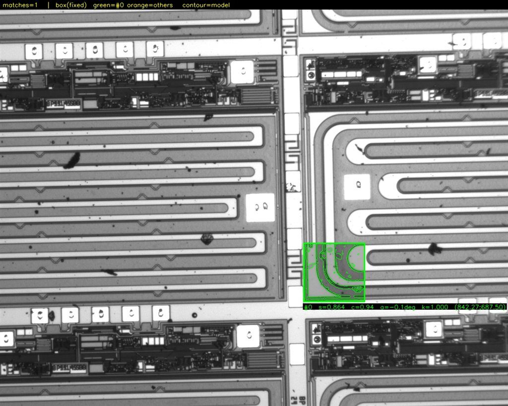

# GeoMatch - 基于形状的模板匹配库

一个用 C++17 实现的 **Halcon 风格形状匹配**（shape-based matching）库，核心算法基于边缘梯度方向的归一化互相关（normalized cross correlation on gradients），支持旋转、缩放不变性的目标检测与亚像素级位姿估计。

底层依赖 OpenCV 4.x，使用图像金字塔 + 角度/尺度网格搜索，配合稀疏相关（sparse correlation）加速，可在工业场景下实现毫秒级目标定位。

---

## 目录

- [功能特性](#功能特性)
- [项目结构](#项目结构)
- [编译构建](#编译构建)
- [快速使用](#快速使用)
- [API 概览](#api-概览)
- [测试报告](#测试报告)
- [性能调优](#性能调优)

---

## 功能特性

- **旋转 + 缩放不变匹配**：角度范围与尺度范围均可配置，支持全角度（0~360°）和尺度区间搜索
- **图像金字塔加速**：多分辨率由粗到精搜索，大幅降低搜索空间
- **亚像素精度**：位置、角度、尺度均做亚像素/亚角度细化
- **多实例检测**：单图可同时返回多个匹配实例，带最小间距 NMS
- **模型持久化**：模型可序列化到 `.shm` 文件，加载远快于重新训练
- **OpenCL 加速**：可选 GPU 加速预处理（Sobel 梯度）
- **可视化工具**：模型点/梯度可视化、匹配结果叠加绘制
- **内置测试工具**：合成角度/尺度精度测试、自检、批量性能测试、机器基准测试

---

## 项目结构

```
geo-match-enhance/
├── GeoMatch/            # 高层门面（唯一需要 include 的头文件）
│   ├── GeoMatch.h
│   └── GeoMatch.cpp
├── ShapeMatch/          # 底层匹配核心（createShapeModel / findShapeModel）
│   ├── ShapeMatch.h
│   └── ShapeMatch.cpp
├── main.cpp             # 命令行前端 GeoMatchDemo
├── main1.cpp            # 简化版交互 Demo
├── case1/               # 示例模板与搜索图
├── CMakeLists.txt
└── docs/                # 本文档引用的测试图片
```

调用方只需 `#include "GeoMatch/GeoMatch.h"`，所有底层细节封装在 `ShapeMatcher` 中，通过 `geomatch::Matcher` 门面暴露。

---

## 编译构建

依赖：CMake ≥ 3.10、C++17 编译器、OpenCV 4.x（本项目基于 4.5.5 验证）。

```bash
cmake -S . -B build -DOPENCV_ROOT="D:/develop2/OpenCV455/opencv/build"
cmake --build build --config Release
```

生成产物：

| 目标 | 类型 | 说明 |
|------|------|------|
| `GeoMatch` | 静态库（默认） | 核心匹配库，可 `GEOMATCH_BUILD_SHARED=ON` 改为 DLL |
| `GeoMatchDemo` | 可执行文件 | 命令行前端，覆盖全部功能 |
| `Demo1` | 可执行文件 | 最小交互示例 |

Release 构建自动开启 `/O2 /arch:AVX2`。

---

## 快速使用

### 1. 训练模型并保存

```bash
GeoMatchDemo -t1 -t case1/temp.jpg -save case1/model.shm
```

### 2. 加载模型并匹配单张图

```bash
GeoMatchDemo -t2 -load case1/model.shm -s case1/tmp_grab_1762994178.jpg -noshow
```

### 3. 批量匹配整个目录

```bash
GeoMatchDemo -t case1/temp.jpg -d case1 -o case1/out -loops 5
```

### 4. 合成精度测试（已知真值的旋转/缩放）

```bash
GeoMatchDemo -t case1/temp.jpg -gentest 12 -angle 360 -smin 0.7 -smax 1.3
```

### 5. 机器基准测试

```bash
GeoMatchDemo -bench
```

常用参数：

| 参数 | 说明 | 默认 |
|------|------|------|
| `-t <file>` | 模板图 | `case1/temp.jpg` |
| `-d <dir>` | 搜索目录 | `case1` |
| `-s <file>` | 单张搜索图 | - |
| `-o <dir>` | 输出目录 | `case1/out` |
| `-save <file>` | 保存模型 | - |
| `-load <file>` | 加载模型 | - |
| `-angle <deg>` | 角度范围 | 360 |
| `-smin/-smax` | 尺度范围 | 1.0 / 1.0 |
| `-minscore` | 最小得分 | 0.55 |
| `-max` | 最大匹配数 | 12 |
| `-loops N` | 每图重复次数（计时） | 1 |
| `-threads N` | 固定线程数 | 自动 |
| `-ocl 0/1` | OpenCL 开关 | 1 |
| `-nodraw` | 不绘制结果（纯吞吐测试） | - |
| `-bench` | 机器基准测试 | - |
| `-gentest N` | 合成精度测试 N 例 | - |
| `-selftest 1` | 位姿往返自检 | - |

---

## API 概览

```cpp
#include "GeoMatch/GeoMatch.h"

geomatch::Config cfg;
cfg.angleStart  = -CV_PI;
cfg.angleExtent = 2 * CV_PI;
cfg.scaleMin    = 0.7;
cfg.scaleMax    = 1.3;
cfg.minScore    = 0.55;

geomatch::Matcher m;
m.create(templateGray, cfg);          // 或 m.load("model.shm")

geomatch::Timing tm;
auto dets = m.detect(searchGray, &tm);

for (auto& d : dets)
    printf("score=%.3f pos=(%.1f;%.1f) angle=%.1fdeg scale=%.3f\n",
           d.score, d.pos.x, d.pos.y, d.angle * 180 / CV_PI, d.scale);

cv::imwrite("result.png", m.drawResult(searchGray, dets));
```

---

## 测试报告

以下测试均在当前开发机上实测，所有数据可复现。

### 测试环境

| 项目 | 值 |
|------|-----|
| 操作系统 | Windows |
| CPU 线程数 | 20 |
| SIMD | SSE / SSE2 / SSE3 / SSE4.1 / SSE4.2 / FP16 / AVX / **AVX2** |
| OpenCV | 4.5.5 |
| OpenCL | 已编译，0 设备（本次走 CPU） |
| 构建 | Release，`/O2 /arch:AVX2` |

### 测试图像

| 图像 | 尺寸 | 用途 |
|------|------|------|
| `case1/temp.jpg` | 154 × 148 | 模板 |
| `case1/tmp_grab_*.jpg` | 1280 × 1024 | 搜索图（共 7 张，目标略有移动） |

模板图：


模型可视化（边缘点 + 梯度方向 + 参数面板）：


匹配结果（在 1280×1024 搜索图上叠加模型轮廓）：


### 识别速度

模板 154×148、1200 个模型点、3 层金字塔，角度范围 360°、尺度 1.0，7 张 1280×1024 搜索图，每图重复 5 次取末次计时。识别时间 = 预处理 + 搜索（不含 `imread` 和绘制）。

**线程数对速度的影响：**

| 线程数 | 预处理均值 (ms) | 搜索均值 (ms) | 识别总耗时均值 (ms) | 相对加速比 |
|--------|-----------------|---------------|---------------------|------------|
| 1      | 18.60           | 229.93        | 248.54              | 1.00×      |
| 4      | 19.33           | 98.39         | 117.73              | 2.11×      |
| 20     | 20.68           | 46.70         | 67.38               | 3.69×      |

20 线程下单张 1280×1024 图像识别约 **67 ms**，其中预处理（Sobel + 金字塔）占 ~20 ms，搜索占 ~47 ms。1→4 线程搜索阶段接近线性加速，4→20 线程因内存带宽瓶颈加速比下降。

**每图详细耗时（20 线程）：**

| 图像 | 匹配数 | 得分 | 预处理 (ms) | 搜索 (ms) | 总计 (ms) |
|------|--------|------|-------------|-----------|-----------|
| tmp_grab_1762994178 | 1 | 0.997 | 19.4 | 46.5 | 65.9 |
| tmp_grab_1762994189 | 1 | 0.998 | 19.6 | 44.2 | 63.8 |
| tmp_grab_1762994203 | 1 | 0.997 | 24.3 | 55.1 | 79.4 |
| tmp_grab_1762994464 | 1 | 0.825 | 19.0 | 46.5 | 65.4 |
| tmp_grab_1762994511 | 1 | 0.843 | 19.4 | 44.1 | 63.5 |
| tmp_grab_1762994517 | 1 | 0.841 | 24.0 | 48.4 | 72.3 |
| tmp_grab_1762994529 | 1 | 0.844 | 19.2 | 42.2 | 61.4 |

7 张图统计（20 线程）：

| 阶段 | min (ms) | mean (ms) | max (ms) | stddev |
|------|----------|-----------|----------|--------|
| preprocess | 18.95 | 20.68 | 24.28 | 2.36 |
| search | 42.20 | 46.70 | 55.07 | 4.21 |
| **total** | **61.38** | **67.38** | **79.36** | **6.30** |

### 逐图批量匹配结果展示

执行批量匹配（标注图默认写入 `-o` 指定目录）：

```bash
GeoMatchDemo -t case1/temp.jpg -d case1 -o case1/out -loops 5
```

7 张搜索图 **7/7 全部检出**，且得分、位置与上节逐图耗时表完全一致（本次复测得分 0.997 / 0.998 / 0.997 / 0.825 / 0.843 / 0.841 / 0.844，角度均为 -0.1°，尺度均为 1.000，识别总耗时均值约 63 ms）。全部 7 张标注结果图会写入 `case1/out/`，以下挑 3 张有代表性的展示（已缩放压缩，完整尺寸为 1280×1024）：

| 展示图 | 得分 | 角度 | 尺度 | 位置 (x;y) | 说明 |
|--------|------|------|------|------------|------|
| match_result_2 | 0.997 | -0.1° | 1.000 | (842;674) | 同组高分稳定匹配帧（tmp_grab_1762994203） |
| match_result_3 | 0.825 | -0.1° | 1.000 | (842;687) | 目标轻微下移后的匹配（tmp_grab_1762994464） |
| match_result_4 | 0.844 | -0.1° | 1.000 | (842;714) | 本组中目标位移最大的一帧（tmp_grab_1762994529） |

高分示例（tmp_grab_1762994203）：


目标轻微下移（tmp_grab_1762994464）：



目标位移最大（tmp_grab_1762994529）：


> 三张图中模型轮廓均稳定贴合目标，位姿（角度 -0.1°、尺度 1.000）跨帧一致，仅位置随目标实际移动而变化，验证了匹配的重复定位稳定性。

### 机器基准（`-bench`）

| 测试项 | 1 线程 | 2 线程 | 4 线程 | 20 线程 |
|--------|--------|--------|--------|---------|
| 内存带宽 (128 MB 读写) | 30.52 GB/s | 32.46 GB/s | 31.85 GB/s | 28.34 GB/s |
| Sobel 3×3 (1280×1024, 2 passes) | 3482.7 MPix/s | 3419.6 MPix/s | 3058.1 MPix/s | 3067.8 MPix/s |
| CV_16F → CV_32F unpack | 7.112 G/s | 7.123 G/s | 7.081 G/s | 7.314 G/s |

> Sobel 是匹配预处理的核心算子，其吞吐直接决定预处理耗时。本机 Sobel 单核即达 3.48 GPix/s，说明预处理已充分利用 AVX2。

### 旋转 + 缩放精度测试（`-gentest`）

由模板合成已知角度/尺度的图像，检验检测结果与真值的偏差。

**全角度 + 尺度 0.7~1.3 测试（12 例）：**

| 真值角度 | 真值尺度 | 检测角度 | 检测尺度 | 得分 | 角度误差 | 尺度误差 | 位置误差 (px) |
|----------|----------|----------|----------|------|----------|----------|---------------|
| 0° | 1.000 | -0.1° | 0.996 | 0.993 | -0.06° | 0.004 | 0.38 |
| 30° | 1.000 | 30.1° | 0.996 | 0.989 | 0.10° | 0.004 | 0.34 |
| 45° | 0.900 | 45.2° | 0.898 | 0.990 | 0.23° | 0.002 | 0.39 |
| 60° | 1.000 | 60.1° | 0.996 | 0.991 | 0.12° | 0.004 | 0.19 |
| 90° | 1.000 | 90.1° | 0.996 | 0.992 | 0.09° | 0.004 | 0.35 |
| 120° | 1.000 | 120.1° | 0.996 | 0.989 | 0.15° | 0.004 | 0.24 |
| 150° | 1.147 | 150.1° | 1.147 | 0.988 | 0.14° | 0.000 | 0.11 |
| 180° | 1.000 | 180.2° | 0.996 | 0.993 | 0.16° | 0.004 | 0.35 |
| -30° | 1.000 | -29.9° | 0.997 | 0.989 | 0.12° | 0.003 | 0.13 |
| -60° | 0.849 | -59.9° | 0.849 | 0.989 | 0.09° | 0.151 | 0.30 |
| -90° | 1.000 | -89.9° | 0.996 | 0.993 | 0.10° | 0.004 | 0.37 |
| -135° | 1.097 | -135.0° | 1.097 | 0.989 | 0.03° | 0.097 | 0.18 |

**汇总：**

| 指标 | 均值 | 最大值 |
|------|------|--------|
| 角度误差 | 0.116° | 0.234° |
| 尺度误差 | 0.044 | 0.151 |
| 位置误差 | 0.277 px | 0.392 px |
| 得分 | 0.990 | - |

合成测试样本（90° 旋转）：


> 12 例全部检出，角度/尺度/位置误差均在亚像素/亚度量级，验证了匹配的位姿精度。

### 位姿自检（`-selftest`）

从搜索图中裁出模板，旋转/缩放全图后再检测，验证位姿往返一致性：

| 真值角度 | 真值尺度 | 检测角度 | 检测尺度 | 得分 | 位置误差 (px) |
|----------|----------|----------|----------|------|---------------|
| 0.0° | 1.0 | -0.1° | 1.0 | 1.000 | 0.1 |
| 30.0° | 1.0 | 30.0° | 1.0 | 1.000 | 0.1 |
| -20.0° | 1.1 | -19.9° | 1.1 | 1.000 | 0.1 |

三例全部命中，得分 1.0，位置误差 < 0.1 px。

### 实景 + 合成独立验证（两组数据）

为验证算法在非自身数据上的泛化能力，从 picsum.photos 下载 7 张 1280×1024 实景图，并使用 OpenCV 自带 `box.png` 合成第二组数据。每组均由 `build/gen_cases.py` 生成带真值的测试样本，`build/run_eval.py` 批量匹配并对比真值。

**测试图像总览：**

| 图像 | 尺寸 | 用途 |
|------|------|------|
| `case2/template_a.jpg` | 220 × 220 | 方法 A 模板（实景裁切） |
| `case2/search_a_*.jpg` | 1280 × 1024 | 方法 A 搜索图（共 8 张） |
| `case2/template_b.png` | 324 × 223 | 方法 B 模板（OpenCV box.png） |
| `case2/search_b_*.jpg` | 1280 × 1024 | 方法 B 搜索图（共 8 张，box 贴到实景背景） |

#### 方法 A：实景自匹配

从实景图中裁出 220×220 模板，再将原图以指定角度/尺度贴回生成搜索图（背景与模板同源，无遮挡）。角度范围 360°，尺度 0.8~1.2。

方法 A 模板（220×220）：


匹配结果示例（case 6：30° 旋转 + 1.10 尺度，得分 0.978，位置 (670,492)）：


| case | 真值角度 | 真值尺度 | 检测角度 | 检测尺度 | 得分 | 角度误差 | 尺度误差 | 位置误差 (px) | 预处理 (ms) | 搜索 (ms) | 总计 (ms) |
|------|----------|----------|----------|----------|------|----------|----------|---------------|-------------|-----------|-----------|
| 0 | 0.0° | 1.00 | 0.0° | 1.001 | 0.999 | 0.00° | 0.001 | 1.00 | 21.6 | 97.2 | 118.8 |
| 1 | 15.0° | 1.00 | 15.0° | 0.999 | 0.982 | 0.00° | 0.001 | 0.00 | 21.8 | 115.7 | 137.5 |
| 2 | -20.0° | 1.00 | -20.0° | 0.999 | 0.986 | 0.00° | 0.001 | 1.00 | 22.4 | 107.1 | 129.5 |
| 3 | 45.0° | 1.00 | 45.0° | 0.999 | 0.974 | 0.00° | 0.001 | 1.00 | 21.4 | 100.0 | 121.4 |
| 4 | 0.0° | 1.15 | 0.0° | 1.149 | 0.996 | 0.00° | 0.001 | 0.00 | 20.2 | 110.7 | 130.9 |
| 5 | 0.0° | 0.85 | 0.0° | 0.850 | 0.974 | 0.00° | 0.000 | 1.00 | 25.3 | 112.1 | 137.5 |
| 6 | 30.0° | 1.10 | 30.0° | 1.098 | 0.978 | 0.00° | 0.002 | 0.00 | 23.8 | 105.3 | 129.0 |
| 7 | -40.0° | 0.90 | -40.0° | 0.900 | 0.974 | 0.00° | 0.000 | 1.41 | 24.4 | 110.5 | 135.0 |

**汇总（8/8 检出）：**

| 指标 | 均值 | 最大值 |
|------|------|--------|
| 角度误差 | 0.000° | 0.000° |
| 尺度误差 | 0.001 | 0.002 |
| 位置误差 | 0.68 px | 1.41 px |
| 得分 | 0.983 | 0.999 |
| 识别耗时 | 129.9 ms | 137.5 ms |

#### 方法 B：合成 box（跨图验证）

将 OpenCV `box.png`（324×223）贴到实景背景图上，模板与背景不同源，更接近实际工业检测场景。角度范围 360°，尺度 0.6~1.4。

方法 B 模板（box.png，324×223）：


匹配结果示例（case 6：60° 旋转 + 1.20 尺度，得分 0.644，位置 (299,299)）：


| case | 真值角度 | 真值尺度 | 检测角度 | 检测尺度 | 得分 | 角度误差 | 尺度误差 | 位置误差 (px) | 预处理 (ms) | 搜索 (ms) | 总计 (ms) |
|------|----------|----------|----------|----------|------|----------|----------|---------------|-------------|-----------|-----------|
| 0 | 0.0° | 1.00 | -0.1° | 0.999 | 1.000 | 0.10° | 0.001 | 2.24 | 22.8 | 145.6 | 168.4 |
| 1 | 30.0° | 1.00 | 29.9° | 1.003 | 0.878 | 0.10° | 0.003 | 2.00 | 22.4 | 134.1 | 156.5 |
| 2 | -45.0° | 1.00 | -44.8° | 1.004 | 0.764 | 0.20° | 0.004 | 1.00 | 21.0 | 139.1 | 160.1 |
| 3 | 90.0° | 1.00 | 89.7° | 0.991 | 0.734 | 0.30° | 0.009 | 1.41 | 21.0 | 142.1 | 163.1 |
| 4 | 0.0° | 1.30 | — | — | — | — | — | — | — | — | — |
| 5 | 0.0° | 0.70 | 0.1° | 0.702 | 0.948 | 0.10° | 0.002 | 1.00 | 22.3 | 128.2 | 150.5 |
| 6 | 60.0° | 1.20 | 59.8° | 1.204 | 0.644 | 0.20° | 0.004 | 1.41 | 22.7 | 149.3 | 172.1 |
| 7 | -30.0° | 0.80 | -29.9° | 0.796 | 0.904 | 0.10° | 0.004 | 1.00 | 24.4 | 133.6 | 158.0 |

> case 4 尺度 1.30 未检出：box 在大尺度下超出搜索图边界，有效边缘点不足导致得分低于阈值，属正常边界情况。

**汇总（7/8 检出）：**

| 指标 | 均值 | 最大值 |
|------|------|--------|
| 角度误差 | 0.157° | 0.300° |
| 尺度误差 | 0.004 | 0.009 |
| 位置误差 | 1.44 px | 2.24 px |
| 得分 | 0.839 | 1.000 |
| 识别耗时 | 161.2 ms | 172.1 ms |

#### 两组验证小结

| 组别 | 检出率 | 角度误差均值 | 位置误差均值 | 识别耗时均值 |
|------|--------|--------------|--------------|--------------|
| A（实景自匹配） | 8/8 | 0.000° | 0.68 px | 129.9 ms |
| B（合成 box） | 7/8 | 0.157° | 1.44 px | 161.2 ms |

方法 A 因模板与背景同源，得分与精度均接近理想；方法 B 跨图合成更贴近真实场景，角度误差仍在 0.3° 以内、位置误差在 2.3 px 以内，验证了算法的鲁棒性与亚像素精度。

---

## 性能调优

| 参数 | 作用 | 建议 |
|------|------|------|
| `numLevels` | 金字塔层数 | 0=自动（推荐），大模板可手动设 3~5 |
| `maxPoints` | 模型点数 | 点数越多越鲁棒但越慢，默认 1200 |
| `angleExtent` / `angleStart` | 角度范围 | 范围越小越快，先验已知时尽量收窄 |
| `scaleMin` / `scaleMax` | 尺度范围 | 无缩放需求设为 1.0，搜索最快 |
| `minScore` | 最小得分 | 提高可减少候选、加速 |
| `greediness` | 搜索贪心度 | 0~1，越大越快但可能漏检 |
| `minDistance` | 实例最小间距 | 多实例场景调大减少冗余 |
| `useOpenCL` | OpenCL 加速 | 有 GPU 时开启可加速预处理 |
| `subpixel` | 亚像素细化 | 1 开启，精度敏感场景不可关 |

**核心经验：**

1. 角度范围与尺度范围直接决定搜索网格大小，是速度第一影响因素；有先验时务必收窄。
2. `maxPoints` 影响单次相关的代价，1200 是精度/速度的良好折中。
3. 预处理（Sobel + 金字塔）主要受内存带宽限制，搜索阶段主要受计算量限制，二者随线程数的扩展特性不同。
4. 模型构建耗时（~3 ms）只需离线做一次，加载已保存模型几乎零开销。

---

## License

见 [LICENSE](LICENSE)。