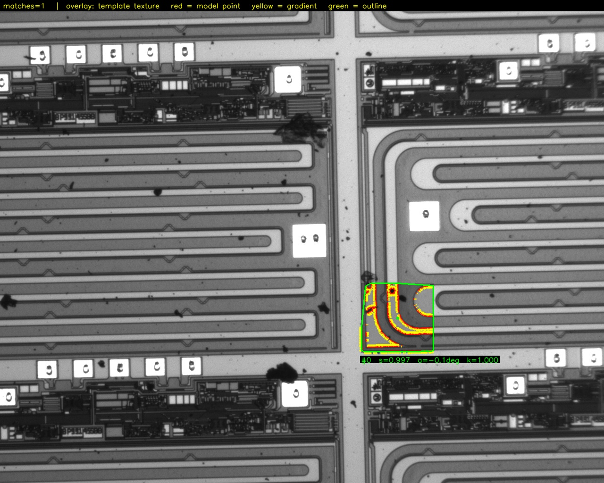
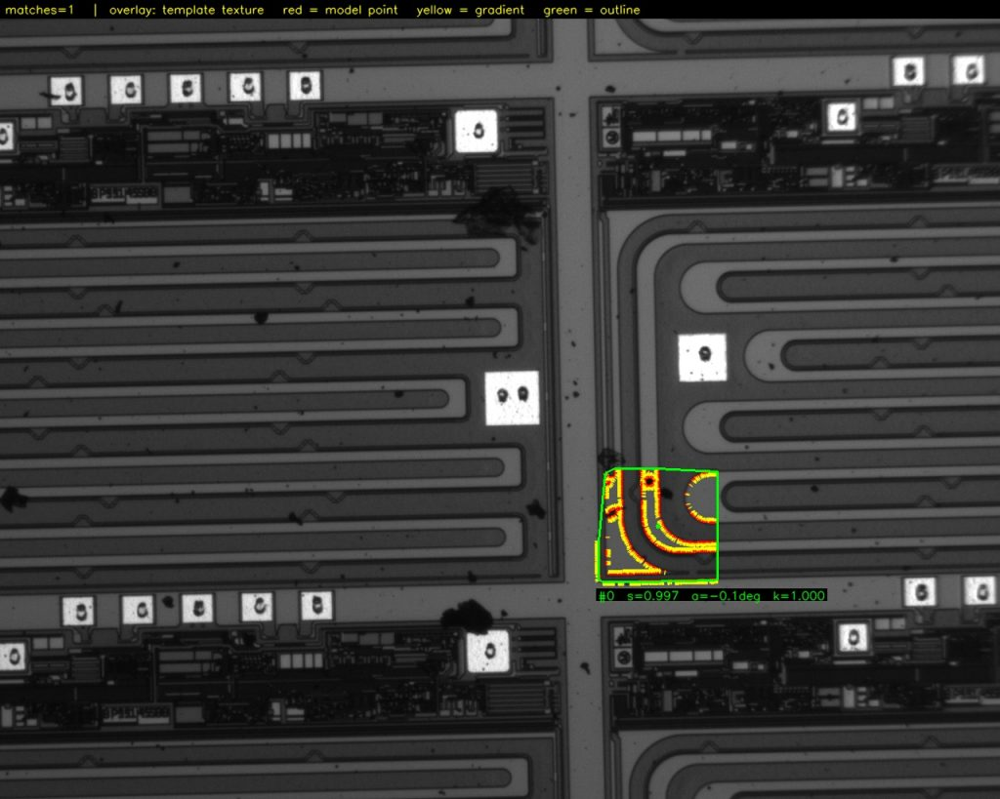
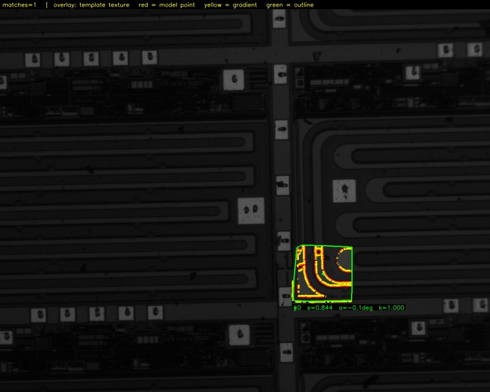
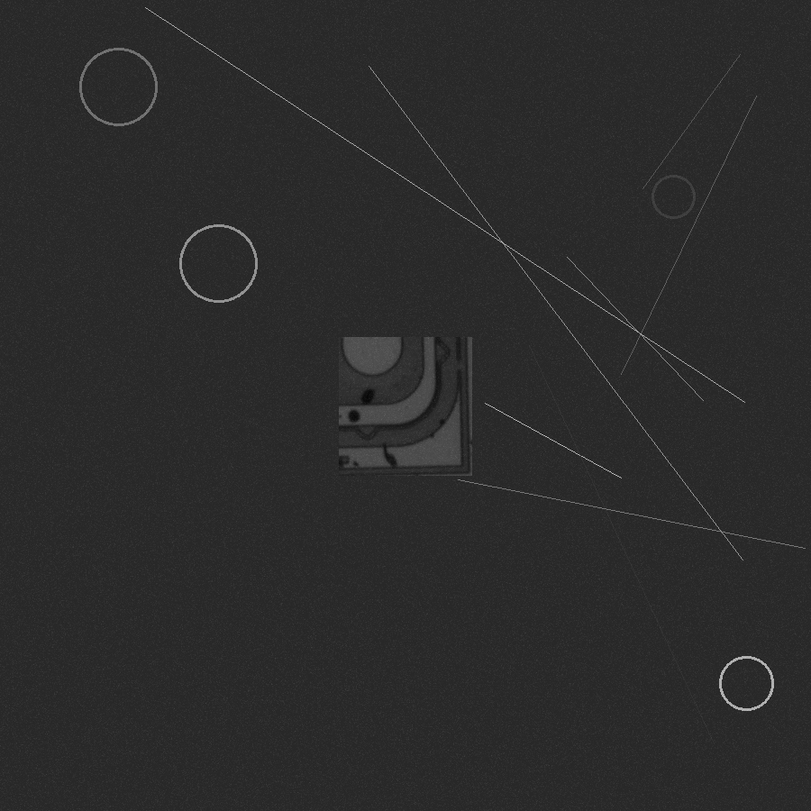
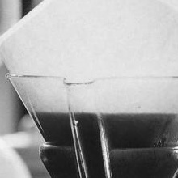
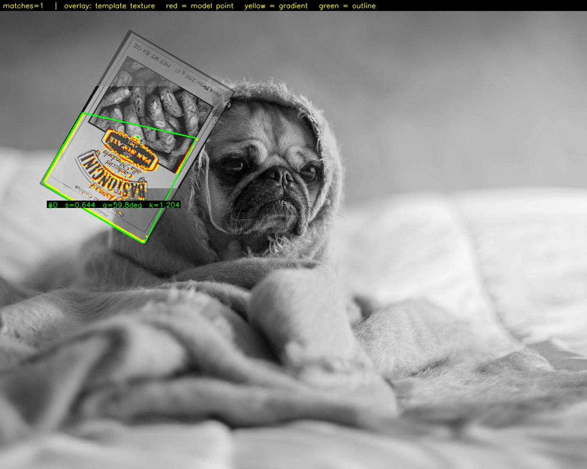

# GeoMatch - 基于形状的模板匹配库

一个用 C++17 实现的 **Halcon 风格形状匹配**（shape-based matching）库，核心算法基于边缘梯度方向的归一化互相关（normalized cross correlation on gradients），支持旋转、缩放不变性的目标检测与亚像素级位姿估计。

底层依赖 OpenCV 4.x，使用图像金字塔 + 角度/尺度网格搜索，配合稀疏相关（sparse correlation）加速，可在工业场景下实现毫秒级目标定位。

---

## 目录

- [功能特性](#功能特性)
- [项目结构](#项目结构)
- [编译构建](#编译构建)
- [快速使用](#快速使用)
- [GUI 工具使用说明](#gui-工具使用说明)
- [API 概览](#api-概览)
- [测试报告](#测试报告)
- [性能调优](#性能调优)

---

## 功能特性

- **旋转 + 缩放不变匹配**：角度范围与尺度范围均可配置，支持全角度（0~360°）和尺度区间搜索
- **图像金字塔加速**：多分辨率由粗到精搜索，大幅降低搜索空间
- **亚像素精度**：位置、角度、尺度均做亚像素/亚角度细化
- **多实例检测**：单图可同时返回多个匹配实例，带最小间距 NMS
- **模型持久化**：模型可序列化到 `.shm` 文件，加载远快于重新训练
- **模板掩码（mask）**：可用掩码图指定仅部分区域参与建模，排除纹理不稳定区域，显著提升分数稳定性
- **OpenCL 加速**：可选 GPU 加速预处理（Sobel 梯度）
- **可视化工具**：模型点/梯度可视化、匹配结果叠加绘制
- **图形界面（GUI）**：`GeoGUIDemo` 提供交互式调参、ROI 框选、掩码涂抹，详见 [GUI 工具使用说明](docs/GeoGUIDemo使用说明.md)
- **内置测试工具**：合成角度/尺度精度测试、自检、批量性能测试、机器基准测试

---

## 项目结构

```
geo-match-enhance/
├── GeoMatch/            # 高层门面（唯一需要 include 的头文件）
│   ├── GeoMatch.h
│   └── GeoMatch.cpp
├── ShapeMatch/          # 底层匹配核心（createShapeModel / findShapeModel）
│   ├── ShapeMatch.h
│   └── ShapeMatch.cpp
├── main.cpp             # 命令行前端 GeoMatchDemo
├── main1.cpp            # 简化版交互 Demo
├── case1/               # 示例模板与搜索图
├── CMakeLists.txt
└── docs/                # 本文档引用的测试图片
```

调用方只需 `#include "GeoMatch/GeoMatch.h"`，所有底层细节封装在 `ShapeMatcher` 中，通过 `geomatch::Matcher` 门面暴露。

---

## 编译构建

依赖：CMake ≥ 3.10、C++17 编译器、OpenCV 4.x（本项目基于 4.5.5 验证）。

```bash
cmake -S . -B build -DOPENCV_ROOT="D:/develop2/OpenCV455/opencv/build"
cmake --build build --config Release
```

生成产物：

| 目标 | 类型 | 说明 |
|------|------|------|
| `GeoMatch` | 静态库（默认） | 核心匹配库，可 `GEOMATCH_BUILD_SHARED=ON` 改为 DLL |
| `GeoMatchDemo` | 可执行文件 | 命令行前端，覆盖全部功能 |
| `Demo1` | 可执行文件 | 最小交互示例 |

Release 构建自动开启 `/O2 /arch:AVX2`。

---

## 快速使用

### 1. 训练模型并保存

```bash
GeoMatchDemo -t1 -t case1/temp.jpg -save case1/model.shm
```

### 2. 加载模型并匹配单张图

```bash
GeoMatchDemo -t2 -load case1/model.shm -s case1/tmp_grab_1762994178.jpg -noshow
```

### 3. 批量匹配整个目录

```bash
GeoMatchDemo -t case1/temp.jpg -d case1 -o case1/out -loops 5
```

### 4. 合成精度测试（已知真值的旋转/缩放）

```bash
GeoMatchDemo -t case1/temp.jpg -gentest 12 -angle 360 -smin 0.7 -smax 1.3
```

### 5. 机器基准测试

```bash
GeoMatchDemo -bench
```

常用参数：

| 参数 | 说明 | 默认 |
|------|------|------|
| `-t <file>` | 模板图 | `case1/temp.jpg` |
| `-d <dir>` | 搜索目录 | `case1` |
| `-s <file>` | 单张搜索图 | - |
| `-o <dir>` | 输出目录 | `case1/out` |
| `-save <file>` | 保存模型 | - |
| `-load <file>` | 加载模型 | - |
| `-angle <deg>` | 角度范围（`-load` 时需显式给出才覆盖模型自带范围） | 360 |
| `-smin/-smax` | 尺度范围 | 1.0 / 1.0 |
| `-mask <file>` | 模板掩码图（非零区域参与建模） | 无（整幅参与） |
| `-minscore` | 最小得分 | 0.55 |
| `-score-mode N` | 最终评分方式：0=mean, 1=positive-mean, 2=trimmed-mean, 3=clipped-mean | 1 |
| `-min-cover X` | 最小覆盖率，0=关闭（见"误检抑制"） | 0 |
| `-max` | 最大匹配数 | 12 |
| `-loops N` | 每图重复次数（计时） | 1 |
| `-threads N` | 固定线程数 | 自动 |
| `-ocl 0/1` | OpenCL 开关 | 1 |
| `-nodraw` | 不绘制结果（纯吞吐测试） | - |
| `-bench` | 机器基准测试 | - |
| `-gentest N` | 合成精度测试 N 例 | - |
| `-selftest 1` | 位姿往返自检 | - |

---

## GUI 工具使用说明

项目附带一个基于 Dear ImGui 的**图形界面**工具 `GeoGUIDemo`，用于交互式地：

- 选择模板图并创建形状模型；
- 在图像上**框选 ROI** 作为模板；
- **涂抹 / 加载掩码（mask）**，精确控制哪些区域参与建模；
- 调整模板/搜索参数并实时观察分数变化；
- 批量匹配一个目录，查看结果表格并保存标注图。

详细的操作步骤、界面布局和配图请参阅：

> 📖 **[GeoGUIDemo 使用说明](docs/GeoGUIDemo使用说明.md)**

启动方式：

```bash
build_x64/GeoGUIDemo.exe            # 直接双击运行
build_x64/GeoGUIDemo.exe case1      # 指定初始目录（默认 case1）
```

---

## API 概览

```cpp
#include "GeoMatch/GeoMatch.h"

geomatch::Config cfg;
cfg.angleStart  = -CV_PI;
cfg.angleExtent = 2 * CV_PI;
cfg.scaleMin    = 0.7;
cfg.scaleMax    = 1.3;
cfg.minScore    = 0.55;

// 可选：模板掩码(非零区域才参与建模)，用于排除纹理不稳定的区域
// cfg.mask = cv::imread("mask.png", cv::IMREAD_GRAYSCALE);

geomatch::Matcher m;
m.create(templateGray, cfg);          // 或 m.load("model.shm")

geomatch::Timing tm;
auto dets = m.detect(searchGray, &tm);

for (auto& d : dets)
    printf("score=%.3f pos=(%.1f;%.1f) angle=%.1fdeg scale=%.3f\n",
           d.score, d.pos.x, d.pos.y, d.angle * 180 / CV_PI, d.scale);

cv::imwrite("result.png", m.drawResult(searchGray, dets));
```

### 结果框样式（`boxMode`）

`drawResult()` 画框的方式可选，**只影响可视化，不影响匹配结果**：

| `boxMode` | 画法 | 适用 |
|---|---|---|
| `0`（默认） | **固定方框**：水平矩形，宽高 = 模板尺寸 × 检测到的 `scale` | 连续多帧对比位置漂移；框不会随 0.1° 的角度抖动而摇摆 |
| `1` | 旋转框：同尺寸，按检测到的角度倾斜 | 需要一眼看出真实位姿 |
| `2` | 模型点凸包：旧版不规则多边形 | 兼容旧结果图；模型点不覆盖四角时框形会很怪 |

```cpp
cfg.boxMode = 0;                       // C++
m.setConfig(cfg);
```

```bash
GeoMatchDemo -load model.shm -d imgs -o out -box 1      # CLI
```

> 固定方框**始终水平**，所以角度信息不体现在框上——它仍然写在框下方的标注里（`a=-20.0deg`）。
> 如果误检时框的位置看着"偏"了，那是 `pos` 的偏移，不是画错。

### 结果图画什么（Halcon 风格）

默认只画**模型轮廓折线**，与 Halcon `dev_display_shape_matching_results()` 的观感一致：
一条细绿线沿着模型边缘走，框住目标的矩形，别无他物。

| 开关 | 默认 | 说明 |
|---|---|---|
| `showContour` | **开** | 模型轮廓折线（拟合到 `get_shape_model_contours` 的效果） |
| `showPoints` | 关 | 采样评分点（红点）；只有轮廓模式下才看得清 |
| `showGradients` | 关 | 梯度箭头（黄）；1 像素宽的轮廓会被它完全盖住 |

```bash
GeoMatchDemo -load model.shm -s img.jpg -o out                  # 默认：只画轮廓
GeoMatchDemo -load model.shm -s img.jpg -o out -show-grads      # 额外画梯度箭头
GeoMatchDemo -load model.shm -s img.jpg -o out -no-contour -show-points -show-grads  # 旧版散点+箭头
```

```cpp
cfg.showContour   = true;   // C++
cfg.showPoints    = false;
cfg.showGradients = false;
```

> 用旧版本保存的 `.shm` 里没有轮廓数据（`chains` 是 v3 才有的），
> 这种情况下自动退回画采样点，结果图不会被留空。

---

## 测试报告

以下测试均在当前开发机上实测，所有数据可复现。

### 测试环境

| 项目 | 值 |
|------|-----|
| 操作系统 | Windows |
| CPU 线程数 | 20 |
| SIMD | SSE / SSE2 / SSE3 / SSE4.1 / SSE4.2 / FP16 / AVX / **AVX2** |
| OpenCV | 4.5.5 |
| OpenCL | 已编译，0 设备（本次走 CPU） |
| 构建 | Release，`/O2 /arch:AVX2` |

### 测试图像

| 图像 | 尺寸 | 用途 |
|------|------|------|
| `case1/temp.jpg` | 154 × 148 | 模板 |
| `case1/tmp_grab_*.jpg` | 1280 × 1024 | 搜索图（共 7 张，目标略有移动） |

模板图：


模型可视化（边缘点 + 梯度方向 + 参数面板）：


匹配结果（在 1280×1024 搜索图上叠加模型轮廓）：



### 识别速度

模板 154×148、1200 个模型点、3 层金字塔，角度范围 360°、尺度 1.0，7 张 1280×1024 搜索图，每图重复 5 次取末次计时。识别时间 = 预处理 + 搜索（不含 `imread` 和绘制）。

**线程数对速度的影响：**

| 线程数 | 预处理均值 (ms) | 搜索均值 (ms) | 识别总耗时均值 (ms) | 相对加速比 |
|--------|-----------------|---------------|---------------------|------------|
| 1      | 18.60           | 229.93        | 248.54              | 1.00×      |
| 4      | 19.33           | 98.39         | 117.73              | 2.11×      |
| 20     | 20.68           | 46.70         | 67.38               | 3.69×      |

20 线程下单张 1280×1024 图像识别约 **67 ms**，其中预处理（Sobel + 金字塔）占 ~20 ms，搜索占 ~47 ms。1→4 线程搜索阶段接近线性加速，4→20 线程因内存带宽瓶颈加速比下降。

**每图详细耗时（20 线程）：**

| 图像 | 匹配数 | 得分 | 预处理 (ms) | 搜索 (ms) | 总计 (ms) |
|------|--------|------|-------------|-----------|-----------|
| tmp_grab_1762994178 | 1 | 0.997 | 19.4 | 46.5 | 65.9 |
| tmp_grab_1762994189 | 1 | 0.998 | 19.6 | 44.2 | 63.8 |
| tmp_grab_1762994203 | 1 | 0.997 | 24.3 | 55.1 | 79.4 |
| tmp_grab_1762994464 | 1 | 0.825 | 19.0 | 46.5 | 65.4 |
| tmp_grab_1762994511 | 1 | 0.843 | 19.4 | 44.1 | 63.5 |
| tmp_grab_1762994517 | 1 | 0.841 | 24.0 | 48.4 | 72.3 |
| tmp_grab_1762994529 | 1 | 0.844 | 19.2 | 42.2 | 61.4 |

7 张图统计（20 线程）：

| 阶段 | min (ms) | mean (ms) | max (ms) | stddev |
|------|----------|-----------|----------|--------|
| preprocess | 18.95 | 20.68 | 24.28 | 2.36 |
| search | 42.20 | 46.70 | 55.07 | 4.21 |
| **total** | **61.38** | **67.38** | **79.36** | **6.30** |

### 逐图批量匹配结果展示

执行批量匹配（标注图默认写入 `-o` 指定目录）：

```bash
GeoMatchDemo -t case1/temp.jpg -d case1 -o case1/out -loops 5
```

7 张搜索图 **7/7 全部检出**，且得分、位置与上节逐图耗时表完全一致（本次复测得分 0.997 / 0.998 / 0.997 / 0.825 / 0.843 / 0.841 / 0.844，角度均为 -0.1°，尺度均为 1.000，识别总耗时均值约 63 ms）。全部 7 张标注结果图会写入 `case1/out/`，以下挑 3 张有代表性的展示（已缩放压缩，完整尺寸为 1280×1024）：

| 展示图 | 得分 | 角度 | 尺度 | 位置 (x;y) | 说明 |
|--------|------|------|------|------------|------|
| match_result_2 | 0.997 | -0.1° | 1.000 | (842;674) | 同组高分稳定匹配帧（tmp_grab_1762994203） |
| match_result_3 | 0.825 | -0.1° | 1.000 | (842;687) | 目标轻微下移后的匹配（tmp_grab_1762994464） |
| match_result_4 | 0.844 | -0.1° | 1.000 | (842;714) | 本组中目标位移最大的一帧（tmp_grab_1762994529） |

高分示例（tmp_grab_1762994203）：



目标轻微下移（tmp_grab_1762994464）：


目标位移最大（tmp_grab_1762994529）：



> 三张图中模型轮廓均稳定贴合目标，位姿（角度 -0.1°、尺度 1.000）跨帧一致，仅位置随目标实际移动而变化，验证了匹配的重复定位稳定性。

### 机器基准（`-bench`）

| 测试项 | 1 线程 | 2 线程 | 4 线程 | 20 线程 |
|--------|--------|--------|--------|---------|
| 内存带宽 (128 MB 读写) | 30.52 GB/s | 32.46 GB/s | 31.85 GB/s | 28.34 GB/s |
| Sobel 3×3 (1280×1024, 2 passes) | 3482.7 MPix/s | 3419.6 MPix/s | 3058.1 MPix/s | 3067.8 MPix/s |
| CV_16F → CV_32F unpack | 7.112 G/s | 7.123 G/s | 7.081 G/s | 7.314 G/s |

> Sobel 是匹配预处理的核心算子，其吞吐直接决定预处理耗时。本机 Sobel 单核即达 3.48 GPix/s，说明预处理已充分利用 AVX2。

### 旋转 + 缩放精度测试（`-gentest`）

由模板合成已知角度/尺度的图像，检验检测结果与真值的偏差。

**全角度 + 尺度 0.7~1.3 测试（12 例）：**

| 真值角度 | 真值尺度 | 检测角度 | 检测尺度 | 得分 | 角度误差 | 尺度误差 | 位置误差 (px) |
|----------|----------|----------|----------|------|----------|----------|---------------|
| 0° | 1.000 | -0.1° | 0.996 | 0.993 | -0.06° | 0.004 | 0.38 |
| 30° | 1.000 | 30.1° | 0.996 | 0.989 | 0.10° | 0.004 | 0.34 |
| 45° | 0.900 | 45.2° | 0.898 | 0.990 | 0.23° | 0.002 | 0.39 |
| 60° | 1.000 | 60.1° | 0.996 | 0.991 | 0.12° | 0.004 | 0.19 |
| 90° | 1.000 | 90.1° | 0.996 | 0.992 | 0.09° | 0.004 | 0.35 |
| 120° | 1.000 | 120.1° | 0.996 | 0.989 | 0.15° | 0.004 | 0.24 |
| 150° | 1.147 | 150.1° | 1.147 | 0.988 | 0.14° | 0.000 | 0.11 |
| 180° | 1.000 | 180.2° | 0.996 | 0.993 | 0.16° | 0.004 | 0.35 |
| -30° | 1.000 | -29.9° | 0.997 | 0.989 | 0.12° | 0.003 | 0.13 |
| -60° | 0.849 | -59.9° | 0.849 | 0.989 | 0.09° | 0.151 | 0.30 |
| -90° | 1.000 | -89.9° | 0.996 | 0.993 | 0.10° | 0.004 | 0.37 |
| -135° | 1.097 | -135.0° | 1.097 | 0.989 | 0.03° | 0.097 | 0.18 |

**汇总：**

| 指标 | 均值 | 最大值 |
|------|------|--------|
| 角度误差 | 0.116° | 0.234° |
| 尺度误差 | 0.044 | 0.151 |
| 位置误差 | 0.277 px | 0.392 px |
| 得分 | 0.990 | - |

合成测试样本（90° 旋转）：



> 12 例全部检出，角度/尺度/位置误差均在亚像素/亚度量级，验证了匹配的位姿精度。

### 位姿自检（`-selftest`）

从搜索图中裁出模板，旋转/缩放全图后再检测，验证位姿往返一致性：

| 真值角度 | 真值尺度 | 检测角度 | 检测尺度 | 得分 | 位置误差 (px) |
|----------|----------|----------|----------|------|---------------|
| 0.0° | 1.0 | -0.1° | 1.0 | 1.000 | 0.1 |
| 30.0° | 1.0 | 30.0° | 1.0 | 1.000 | 0.1 |
| -20.0° | 1.1 | -19.9° | 1.1 | 1.000 | 0.1 |

三例全部命中，得分 1.0，位置误差 < 0.1 px。

### 实景 + 合成独立验证（两组数据）

为验证算法在非自身数据上的泛化能力，从 picsum.photos 下载 7 张 1280×1024 实景图，并使用 OpenCV 自带 `box.png` 合成第二组数据。每组均由 `build/gen_cases.py` 生成带真值的测试样本，`build/run_eval.py` 批量匹配并对比真值。

**测试图像总览：**

| 图像 | 尺寸 | 用途 |
|------|------|------|
| `case2/template_a.jpg` | 220 × 220 | 方法 A 模板（实景裁切） |
| `case2/search_a_*.jpg` | 1280 × 1024 | 方法 A 搜索图（共 8 张） |
| `case2/template_b.png` | 324 × 223 | 方法 B 模板（OpenCV box.png） |
| `case2/search_b_*.jpg` | 1280 × 1024 | 方法 B 搜索图（共 8 张，box 贴到实景背景） |

#### 方法 A：实景自匹配

从实景图中裁出 220×220 模板，再将原图以指定角度/尺度贴回生成搜索图（背景与模板同源，无遮挡）。角度范围 360°，尺度 0.8~1.2。

方法 A 模板（220×220）：



匹配结果示例（case 6：30° 旋转 + 1.10 尺度，得分 0.978，位置 (670,492)）：


| case | 真值角度 | 真值尺度 | 检测角度 | 检测尺度 | 得分 | 角度误差 | 尺度误差 | 位置误差 (px) | 预处理 (ms) | 搜索 (ms) | 总计 (ms) |
|------|----------|----------|----------|----------|------|----------|----------|---------------|-------------|-----------|-----------|
| 0 | 0.0° | 1.00 | 0.0° | 1.001 | 0.999 | 0.00° | 0.001 | 1.00 | 21.6 | 97.2 | 118.8 |
| 1 | 15.0° | 1.00 | 15.0° | 0.999 | 0.982 | 0.00° | 0.001 | 0.00 | 21.8 | 115.7 | 137.5 |
| 2 | -20.0° | 1.00 | -20.0° | 0.999 | 0.986 | 0.00° | 0.001 | 1.00 | 22.4 | 107.1 | 129.5 |
| 3 | 45.0° | 1.00 | 45.0° | 0.999 | 0.974 | 0.00° | 0.001 | 1.00 | 21.4 | 100.0 | 121.4 |
| 4 | 0.0° | 1.15 | 0.0° | 1.149 | 0.996 | 0.00° | 0.001 | 0.00 | 20.2 | 110.7 | 130.9 |
| 5 | 0.0° | 0.85 | 0.0° | 0.850 | 0.974 | 0.00° | 0.000 | 1.00 | 25.3 | 112.1 | 137.5 |
| 6 | 30.0° | 1.10 | 30.0° | 1.098 | 0.978 | 0.00° | 0.002 | 0.00 | 23.8 | 105.3 | 129.0 |
| 7 | -40.0° | 0.90 | -40.0° | 0.900 | 0.974 | 0.00° | 0.000 | 1.41 | 24.4 | 110.5 | 135.0 |

**汇总（8/8 检出）：**

| 指标 | 均值 | 最大值 |
|------|------|--------|
| 角度误差 | 0.000° | 0.000° |
| 尺度误差 | 0.001 | 0.002 |
| 位置误差 | 0.68 px | 1.41 px |
| 得分 | 0.983 | 0.999 |
| 识别耗时 | 129.9 ms | 137.5 ms |

#### 方法 B：合成 box（跨图验证）

将 OpenCV `box.png`（324×223）贴到实景背景图上，模板与背景不同源，更接近实际工业检测场景。角度范围 360°，尺度 0.6~1.4。

方法 B 模板（box.png，324×223）：


匹配结果示例（case 6：60° 旋转 + 1.20 尺度，得分 0.644，位置 (299,299)）：



| case | 真值角度 | 真值尺度 | 检测角度 | 检测尺度 | 得分 | 角度误差 | 尺度误差 | 位置误差 (px) | 预处理 (ms) | 搜索 (ms) | 总计 (ms) |
|------|----------|----------|----------|----------|------|----------|----------|---------------|-------------|-----------|-----------|
| 0 | 0.0° | 1.00 | -0.1° | 0.999 | 1.000 | 0.10° | 0.001 | 2.24 | 22.8 | 145.6 | 168.4 |
| 1 | 30.0° | 1.00 | 29.9° | 1.003 | 0.878 | 0.10° | 0.003 | 2.00 | 22.4 | 134.1 | 156.5 |
| 2 | -45.0° | 1.00 | -44.8° | 1.004 | 0.764 | 0.20° | 0.004 | 1.00 | 21.0 | 139.1 | 160.1 |
| 3 | 90.0° | 1.00 | 89.7° | 0.991 | 0.734 | 0.30° | 0.009 | 1.41 | 21.0 | 142.1 | 163.1 |
| 4 | 0.0° | 1.30 | — | — | — | — | — | — | — | — | — |
| 5 | 0.0° | 0.70 | 0.1° | 0.702 | 0.948 | 0.10° | 0.002 | 1.00 | 22.3 | 128.2 | 150.5 |
| 6 | 60.0° | 1.20 | 59.8° | 1.204 | 0.644 | 0.20° | 0.004 | 1.41 | 22.7 | 149.3 | 172.1 |
| 7 | -30.0° | 0.80 | -29.9° | 0.796 | 0.904 | 0.10° | 0.004 | 1.00 | 24.4 | 133.6 | 158.0 |

> case 4 尺度 1.30 未检出：box 在大尺度下超出搜索图边界，有效边缘点不足导致得分低于阈值，属正常边界情况。

**汇总（7/8 检出）：**

| 指标 | 均值 | 最大值 |
|------|------|--------|
| 角度误差 | 0.157° | 0.300° |
| 尺度误差 | 0.004 | 0.009 |
| 位置误差 | 1.44 px | 2.24 px |
| 得分 | 0.839 | 1.000 |
| 识别耗时 | 161.2 ms | 172.1 ms |

#### 两组验证小结

| 组别 | 检出率 | 角度误差均值 | 位置误差均值 | 识别耗时均值 |
|------|--------|--------------|--------------|--------------|
| A（实景自匹配） | 8/8 | 0.000° | 0.68 px | 129.9 ms |
| B（合成 box） | 7/8 | 0.157° | 1.44 px | 161.2 ms |

方法 A 因模板与背景同源，得分与精度均接近理想；方法 B 跨图合成更贴近真实场景，角度误差仍在 0.3° 以内、位置误差在 2.3 px 以内，验证了算法的鲁棒性与亚像素精度。

---

## 性能调优

| 参数 | 作用 | 建议 |
|------|------|------|
| `numLevels` | 金字塔层数 | 0=自动（推荐）。**不要设 1**：会退化成全分辨率暴力搜索，比 3 层慢 130 倍且结果完全相同，详见下节 |
| `maxPoints` | 模型点数 | 点数越多越鲁棒但越慢，默认 1200 |
| `angleExtent` / `angleStart` | 角度范围 | 范围越小越快，先验已知时尽量收窄 |
| `scaleMin` / `scaleMax` | 尺度范围 | 无缩放需求设为 1.0，搜索最快 |
| `mask` | 模板掩码（非零区域参与建模） | 排除晶粒/纹理不稳定区域可大幅提升分数稳定性 |
| `minScore` | 最小得分 | 提高可减少候选、加速 |
| `scoreMode` | 最终评分方式 | 调低 `minScore` 追召回时改用 3（clipped-mean），见下节 |
| `minCoverage` | 最小覆盖率（0=关闭） | 调低 `minScore` 后误检多时开启，0.75~0.90 起调 |
| `greediness` | 搜索贪心度 | 0~1，越大越快但可能漏检 |
| `minDistance` | 实例最小间距 | 多实例场景调大减少冗余 |
| `useOpenCL` | OpenCL 加速 | 有 GPU 时开启可加速预处理 |
| `subpixel` | 亚像素细化 | 1 开启，精度敏感场景不可关 |
| `minContrast` (lo) | 滞后**低**阈值：边缘像素的最低梯度幅值 | 见下节「对比度阈值」 |
| `contrast` (hi) | 滞后**高**阈值：种子像素的梯度幅值 | 与 `minContrast` 相等 = 纯阈值 |
| `boxMode` | 结果框样式（只影响 `drawResult()` 画出来的样子） | 0=固定方框(默认) / 1=旋转框 / 2=模型凸包 |
| `showContour` | 结果图上画模型轮廓折线（Halcon 风格） | 默认开；关掉后不画模型 |
| `showPoints` | 结果图上画采样评分点 | 默认关，诊断时开 |
| `showGradients` | 结果图上画梯度箭头 | 默认关，会盖住细轮廓 |

**核心经验：**

1. 角度范围与尺度范围直接决定搜索网格大小，是速度第一影响因素；有先验时务必收窄。
2. `maxPoints` 影响单次相关的代价，1200 是精度/速度的良好折中。
3. 预处理（Sobel + 金字塔）主要受内存带宽限制，搜索阶段主要受计算量限制，二者随线程数的扩展特性不同。
4. 模型构建耗时（~3 ms）只需离线做一次，加载已保存模型几乎零开销。
5. **模板掩码是分数稳定性的关键**：若模板内存在随帧变化的纹理（如晶圆 die 表面的颗粒/反光），应只对稳定几何特征（如街道线条）建模。实测将 667 帧的 ≥0.70 高分占比从 36% 提升到 100%、std 从 0.191 降至 0.081。

### 金字塔层数：为什么 `numLevels = 1` 特别慢

搜索是**由粗到精**的：只在最粗的一层做全图扫描，逐层向下只精修少量候选。

| 层数 | 最粗层 | 扫描角度数 | 每层图像像素 | 每层模型点 | 全图扫描量 |
|---|---|---|---|---|---|
| 3 | level 2 | 658 / 2² = **165** | 1/4² = 1/16 | 1200/2² = 300 | 相对 **1×** |
| 1 | level 0 | 658 / 2⁰ = **658** | 1/1 | 1200 | 相对 **≈130×** |

单个位姿的耗时 ∝ 图像像素 × 模型点数；层数每升 1，这两个量分别除以 4 和 2（共 8×），
同时扫描的角度数还除以 2（`strideA = 1 << top`），合计 **每多一层省约 14~16 倍**。

`numLevels = 1` 时 `top = 0`，于是：

- 粗扫描直接跑在**全分辨率**上（1280×1024，而不是 320×256）；
- `strideA = 1<<0 = 1`，658 个角度**全部**要扫；
- 精修循环 `for (l = top-1; l >= 0; l--)` 一次都不执行（debug 里 `refine=0`）。

实测（搜索图 1280×1024，`greediness=0.9`，3 次取最后一次）：

| 模板 | 层数 | 搜索耗时 | 匹配结果 |
|---|---|---|---|
| 154×148 | 1 | **6069 ms** | s=0.988 (842;674) a=-0.1° |
| 154×148 | 2 | 422 ms | 同上 |
| 154×148 | 3 / 0(自动) | **44 ms** | 同上 |
| 355×414 | 1 | **2604 ms** | — |
| 355×414 | 2 | 188 ms | — |
| 355×414 | 3 | 15 ms | — |
| 355×414 | 4 / 0(自动) | **4.3 ms** | — |

**结果完全一样**：最终位姿与分数永远在 level 0 上重算（`refineLevel` 一直细化到 0，`subpixelRefine(0, …)`
和 `scorePoseDetail(srcGx_[0], …)` 也只读 level 0）。所以调高金字塔层数**不损失精度**，
它只决定"用多粗的图去找候选"。设成 1 等于放弃加速，白白慢两个数量级。

> 层数也不是越大越好：`minSide = 24` 会截断（154×148 的模板最多 3 层，355×414 最多 4 层）；
> 而且目标在粗层上可能糊掉，层数过多会漏掉候选。用 `0`（自动）即可。


### 对比度阈值：`minContrast` / `contrast` 的量纲与滞后判据

建模板时用**滞后阈值**从模板图里选点（和 Halcon `create_shape_model` 的 `Contrast` 同构）：

```
Sobel(3x3) -> NMS 细化 -> 滞后生长: |g| >= hi 作种子, 沿 8 邻域扩到 |g| >= lo
```

| 参数 | 含义 | 库内部单位 |
|---|---|---|
| `minContrast` | 滞后低阈值，弱边能不能被保留 | Sobel `|g|`（float） |
| `contrast` | 滞后高阈值，哪些像素当种子 | Sobel `|g|` |

- **量纲**：一个理想硬台阶（灰度差 ΔG）的 Sobel 幅值 ≈ **4 × ΔG**；σ=1 的高斯模糊边缘约 2.6 × ΔG。
  所以 `minContrast = 12` 大约对应灰度差 3。GUI 的「最小对比度(灰度差)」就是按 `/4` 换算后的值，可以和 Halcon 的对比度直接对着看。
- **`hi` 必须 >= `lo`**，两者相等时退化成纯阈值（= Halcon 只给一个 Contrast 值）。
  低段要保证 `hi` 比 `lo` 高一点才有滞后分离度；高段 `hi` 一旦超过模板里最强的边，**种子数为 0，模型点会瞬间全灭**。
  本机 `case1/temp.jpg`（154×148）的 Sobel 峰值只有 152（≈灰度差 38），所以：
  按 `hi = 1.15*lo + 2` 跟随时，灰度差 3→32 是一条连续下降曲线（3929→3232→2404→1462→1159→730→184→24→0），
  而早期版本用 `hi = max(contrast, 1.5*lo)`，灰度差 20 就直接 0 点（20~255 全是死区）。
- **点数被 `maxPoints` 截断**时，调阈值只会改变"取哪些点"，不会改变点数。
  `GeoMatch::candidatePixels()`（GUI 建模板日志里会打印）是"过了阈值的像素数"：
  远大于 `modelPointCount()` 就说明是 `maxPoints` 在起效，此时看"腐蚀"要看候选像素数而不是点数。

---

## 误检抑制：调低 minScore 后分数虚高怎么办

### 现象与根因

把 `minScore` 调低（例如 0.3）追召回时，会在"不像"的位置上也报出高分。这不是搜索 bug，而是三个原因叠加：

1. **模板本身判别力不足**。`case1/temp.jpg` 这类模板是一个"内圆角 + 十字街道"的通用几何，晶圆上每个 cell 都有同样的圆角，模型点在全图重复出现。
2. **图形是周期性的**。重复结构之间的互相关天然很高，任何基于方向点积的算法（含 Halcon）都会在多处出峰。
3. **positive-mean 会放大误检分数**。它只统计方向一致的点并把它们当分母，于是"只对上一半"的位置也能拿到高分——判别间隔被压缩。

### case1 上的单点对比

模板 154×148、1200 点，`-minscore 0.3 -max 8`：

| 位置 | 性质 | `scoreMode=1`（默认 positive-mean） | `scoreMode=3`（clipped-mean） | 覆盖率 |
|------|------|------|------|------|
| (841,674) | 真实目标 | 0.988 | 0.982 | **0.99** |
| (848,318) | 相似结构（误检） | 0.860 | 0.539 | 0.63 |
| (835,405) | 相似结构（误检） | 0.843 | 0.519 | 0.62 |

判别间隔从 **0.13 → 0.44**，真值分数几乎不变，代价 ≈ 0（同一张图 62 ms → 64 ms）。

### case3 整集验证（180 帧，50 帧有十字 / 130 帧没有）

`release_GeoGUIDemo_x64/case3` 是载物台移动的产线数据：同一工位 180 帧，其中 50 帧视野里有完整十字路口、
另外 130 帧十字已经移出视野。**正确行为是：前 50 帧各报 1 个、后 130 帧报 0 个**。
（真值由独立 OpenCV `TM_CCOEFF_NORMED` 确定：NCC≥0.94 恰好 50 帧，其余 130 帧 NCC 全部 <0.5，边界非常干净。）

这个数据集暴露的问题比 case1 严重得多：**默认参数 `minScore=0.55` 就已经 precision 只有 0.505**。

| 配置 | TP | FP | FN | precision | recall | F1 |
|------|----|----|----|-----------|--------|-----|
| 默认 `ms=.55, sm=1` | 50 | **49** | 0 | 0.505 | 1.000 | 0.671 |
| `ms=.30, sm=1`（降阈值追召回） | 50 | 54 | 0 | 0.481 | 1.000 | 0.649 |
| `ms=.30, sm=3` | 50 | 54 | 0 | 0.481 | 1.000 | 0.649 |
| **默认 `ms=.55, sm=1` + `cov>=.78`** | 49 | **1** | 1 | **0.980** | 0.980 | **0.980** |
| `ms=.30, sm=3` + `cov>=.78` | 49 | 1 | 1 | 0.980 | 0.980 | 0.980 |
| `ms=.30, sm=3` + `cov>=.80` | 42 | 0 | 8 | 1.000 | 0.840 | 0.913 |
| `ms=.30, sm=3` + `cov>=.82` | 10 | 0 | 40 | 1.000 | 0.200 | 0.333 |
| 掩码=十字（只用十字带建模，`ms=.55`） | 50 | 9 | 0 | 0.847 | 1.000 | 0.917 |
| 掩码=十字 + `cov>=.80` | 50 | 4 | 0 | 0.926 | **1.000** | 0.962 |
| `ms=.68, sm=3`（等效"事后分数阈值 0.72"） | 50 | 0 | 0 | **1.000** | **1.000** | **1.000** |

据此得到四条实测结论：

1. **`minCoverage` 是主贡献者**：只加一个 `-min-cover 0.78`，默认参数下 F1 就从 0.671 提到 0.980。
2. **`scoreMode=3` 不会自己减少误检数量**。它只改分数、不改位置，所以在同一个 `minScore` 下检测集合与 `sm=1` 完全相同。
3. **`scoreMode=3` 的价值在于把误检分数压下去，从而让"分数阈值"变得可用**。固定搜索阈值 `ms=.30`，只扫事后分数阈值：

   | 评分方式 | 最优分数阈值 | TP | FP | F1 |
   |---|---|---|---|---|
   | `sm=1` positive-mean | 0.92 | 50 | 29 | 0.775 |
   | `sm=3` clipped-mean | **0.72** | 50 | **0** | **1.000** |

   原因：同样这批误检，`positive-mean` 给 0.92（几乎和真值 0.94 一样），
   `clipped-mean` 只给 0.67（真值 0.77）——判别间隔从 0.03 拉开到 0.10。
4. **`minScore` 同时参与搜索剪枝**（`topTarget = minScore × 0.55`），所以提高它省不掉召回损失：
   `ms=.85` 时 recall 直接掉到 0.02。**正确姿势是"搜索阈值保持低、靠事后分数/覆盖率筛"，而不是靠抬高 `minScore`。**

### 三级解法（按代价从低到高）

**1. 加覆盖率下限（先做这个，一个参数）**

覆盖率 = 方向一致的模型点占比 = `(#dot>0) / n`，由 `minCoverage` 控制（默认 0 关闭）。
它是"整个模型是不是都在"的直接度量：误检位置往往只是碰巧对上了模型的一部分。

```bash
# case3：默认参数，只加覆盖率门槛
GeoMatchDemo -load model.shm -d case3 -min-cover 0.78     # FP 49 -> 1
```

- CLI：`-min-cover 0.78`；C++：`cfg.minCoverage = 0.78f;`；AnalyzeCase：`--min-cover 0.78`
- GUI：拖动「最小覆盖率」滑块，结果表新增的「覆盖」列可以直接看到每个候选的覆盖率，
  **先用它标定阈值**（真值与误检的覆盖率差多少），再定门限。
- 代价：每个上报结果多一遍 n 点扫描（结果数 ≤ `maxMatches`，实测 < 2 ms）。
- 注意：被覆盖率滤掉的候选不会由排名更低的候选补位，因此 `matches` 可能少于 `maxMatches`——这正是过滤的目的。
- **阈值要按数据标定，不能照抄**。case1 是 0.99 vs 0.62（取 0.80 很安全）；case3 是 0.81 vs 0.75
  （只有 0.78~0.80 这很窄的一段能用，0.82 就把召回打没了）。差得越开，阈值越好定。

**2. 换评分方式（让分数本身可用于筛选）**

`scoreMode = 3`（clipped-mean）：只累加方向一致的贡献，但**分母仍然是模型点数 n**。
`positive-mean`（`scoreMode = 1`）属于"只算好点"，部分匹配也能虚高；clipped-mean 让"只对上 60% 的模型"最多只能拿到 0.6 左右。

```bash
GeoMatchDemo -t tpl.png -d imgs -minscore 0.30 -score-mode 3    # 看分数分布
# 标定好分数阈值后再跑：
GeoMatchDemo -t tpl.png -d imgs -minscore 0.30 -score-mode 3 -min-cover 0.78
```

C++ 里等价于 `cfg.scoreMode = 3;`，GUI 里在「搜索参数 → 评分方式」选 `clipped-mean`。

**3. 从建模层面消灭歧义（治本）**

- **涂掩码，只保留唯一结构**。case3 的实测：把四个角的重复器件阵列涂掉、只留十字带，
  单这一项就把 FP 从 49 降到 9（F1 0.671 → 0.917），再叠 `cov>=.80` 得到 FP=4、F1 0.962 且召回不掉。
  GUI 的「涂抹掩码模式」就是为这个准备的。
  （注意掩码会让分数整体下移，`minScore` 要相应放低；上表用的是同样的 `ms=.55`。）
- **收窄 ROI**：只框"只有这一处才有"的几何（唯一的缺口、字符、非对称角）。
- **收窄 `angleStart/angleExtent`、`scaleMin/scaleMax`**：搜索空间越小，假峰越少，同时也更快。
- **加位置先验**：若工位固定（目标一定出现在某个区域），把搜索范围裁剪到该 ROI 内，比任何评分技巧都可靠。
- **多实例场景**：用 `minDistance` 抑制相邻周期，用 `maxMatches` 限制输出条数。
- ⚠️ **`minContrast` / `maxPoints` 不是越多/越高越好**。case3 实测：把 `minContrast` 提到 30/50，
  FP 反而从 49 涨到 75/102（点集中到了同样重复的强边缘）；`maxPoints` 在 150/200/250/300/350/500/800
  上的 F1 是 0.47/0.83/**1.00**/0.44/0.15/0.04/1.00，**非单调、不可作为通用手段**。
  这两个参数要配合掩码一起用，单独调很难控制。

### 怎么判断"该调哪个"

1. 保持 `minScore` 低一点，先让所有候选都出来；
2. 看「覆盖」列：真值与误检的**覆盖率差**是否明显？
   - 明显（如 case1 的 0.99 vs 0.62）→ 直接用覆盖率阈值；
   - 勉强（如 case3 的 0.81 vs 0.75）→ 覆盖率只能救急，去第 3 步改模板/掩码；
3. 切到 `clipped-mean` 再看分数分布：真值与误检的分数是否分得开？分得开就"低搜索阈值 + 高分数阈值"；
4. 如果两者都分不开，说明模板里根本没有判别信息——必须是改模板/掩码/加位置先验，继续调阈值只会两头受损。

---


## License

见 [LICENSE](LICENSE)。