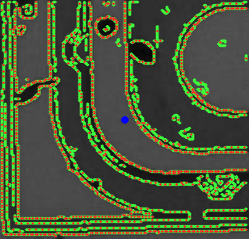
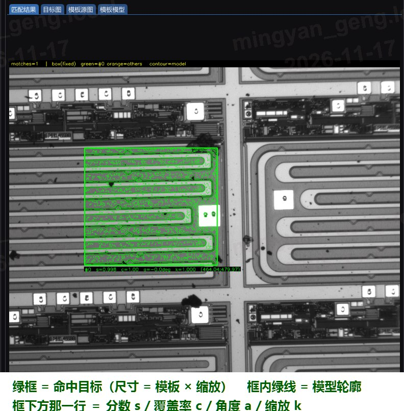
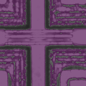
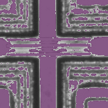

# GeoGUIDemo 使用说明（图文操作手册）

> 本文档面向第一次接触 GeoGUIDemo 的用户，按"界面长什么样 → 每一步点什么 → 结果怎么看"的顺序讲解。
> 建议配合程序实际操作一遍，10 分钟内即可上手。

---

## 一、这是什么？

**GeoGUIDemo** 是一个基于 Dear ImGui 的**图形化模板匹配验证工具**。它的作用是：

1. 选一张**模板图**（你要找的目标的样子）；
2. 在模板图上**框选 ROI** 或**涂抹掩码**，决定哪些区域参与建模；
3. 创建**形状模型**；
4. 拿模型去**一张图或一整个目录**里做匹配，找到目标的位置/角度/尺度，并给出得分。

它对应命令行 `GeoMatchDemo.exe` 的图形版，适合**交互式调参**：拖一下滑块立刻看到分数变化。

---

## 二、如何启动

**方式 A：直接双击**
```
build_x64\GeoGUIDemo.exe
```
（或你常用的 `build\GeoGUIDemo.exe`，两个目录都有生成产物）

**方式 B：命令行带参数启动**（可指定初始目录）
```
build_x64\GeoGUIDemo.exe case1
```
`case1` 是默认目录，程序启动时会**自动**读取该目录下的 `temp.jpg` 建模板，并拿目录里第一张其它图跑一次匹配，方便你直接看到效果。

> 首次启动若提示找不到 `opencv_world455.dll`，把 `build_x64\opencv_world455.dll` 拷贝到 exe 同目录即可（见《常见问题》）。

---

## 三、界面总览

启动后窗口分**左右两栏**：

```
┌──────────────────────────────────────────────────────────────────┐
│  GeoMatch 模板匹配验证工具                                        │
├────────────────────────────────────────┬─────────────────────────┤
│  左栏（图像视图区）                     │  右栏（操作面板）        │
│ ┌────────────────────────────────────┐ │                         │
│ │ [匹配结果][目标图][模板源图][模板模型] │ ← 4 个标签页          │
│ │                                    │ │ ─ 1. 模板图像 ─        │
│ │         图像显示区                  │ │   [选择模板图片...]     │
│ │   (可框选 ROI / 涂抹掩码)           │ │ ─ 模板参数 ─           │
│ │                                    │ │   起始角 / 尺度 / ...   │
│ ├────────────────────────────────────┤ │   [加载掩码][清除掩码] │
│ │ 图片列表(缩略图, 横向滚动)          │ │   [涂抹掩码模式]       │
│ │ [缩略1][缩略2][缩略3] ...           │ │   [创建模板]           │
│ └────────────────────────────────────┘ │ ─ 2. 匹配目标 ─        │
│                                        │   [选择图片目录...]     │
│                                        │   [选择单张图片...]     │
│                                        │ ─ 3. 搜索参数 ─        │
│                                        │   最小分数 / 最大匹配数 │
│                                        │ ─ 4. 执行匹配 ─        │
│                                        │   [执行匹配] [保存结果图]│
│                                        │   结果表格              │
│                                        │ ─ 日志 ─               │
│                                        │   ...（滚动日志）       │
└────────────────────────────────────────┴─────────────────────────┘
```

**记住一句话**：**左边是"看"，右边是"操作"。**

---

## 四、快速上手：三步完成一次匹配

### 第 1 步：选模板图

在右栏「**1. 模板图像**」区块，点 **`选择模板图片...`**，在弹出的文件对话框里选一张图（例如 `case1/temp.jpg`）。

选完后：
- 左栏「**模板源图**」标签页会显示这张图；
- 程序若勾选了「自动运行」，会**立即**创建模板并匹配一次。

### 第 2 步：创建模板

确认右栏「**模板参数**」里的参数没问题（首次保持默认即可），点 **`创建模板`** 按钮。

创建成功后，左栏「**模板模型**」标签页会显示**特征点 + 梯度方向**可视化图（红点=模型点，绿线=梯度方向，蓝点=中心），日志区会打印 `模板已创建: ... 点数=... 层数=...`。

**创建模板后，切到「模板模型」标签页看到的画面**（红点=模型特征点，绿线=每个点的梯度方向，蓝点=模板中心）：



> **这一步是关键检查点**：红点应该集中在你想找的目标轮廓上。如果红点散落到无关背景或纹理上，说明需要框选 ROI（第六节）或用掩码排除（第七节）。

### 第 3 步：选择目标并执行匹配

在右栏「**2. 匹配目标**」区块：
- **匹配单张**：点 `选择单张图片...`；
- **匹配整个目录**：点 `选择图片目录...`。

然后在「**4. 执行匹配**」区块点 **`执行匹配`**。

匹配完成后：
- 左栏「**匹配结果**」标签页会显示叠加了模型轮廓的结果图；
- 右栏出现**结果表格**（分数、位置、角度、尺度）；
- 底部日志区打印每张图的耗时和命中情况。

**匹配完成后，「匹配结果」标签页看到的画面**（绿色轮廓=匹配到的目标，中心绿点=定位点，左上角红字=分数）：



---

## 五、左侧图像视图：4 个标签页详解

左栏顶部有 4 个标签页，点击切换：

| 标签页 | 内容 | 能否交互 |
|--------|------|----------|
| **匹配结果** | 匹配结果图（叠加轮廓/特征点） | 可框选 ROI |
| **目标图** | 当前搜索目标原图 | 可框选 ROI |
| **模板源图** | 模板原图 | 可框选 ROI + **涂抹掩码** |
| **模板模型** | 模型特征点 + 梯度方向可视化 | 仅查看 |

**显示缩放**：右栏「4. 执行匹配」区块上方有 `显示缩放` 滑块（0.2~4.0），用于放大/缩小图像显示，**不影响**匹配算法，只是看得更清楚。

**图片列表**：左栏底部是一条**缩略图横向滚动条**，列出了目标目录里所有图片，点击某个缩略图即可切换当前匹配目标。

### 可视化效果示例（真实程序输出）

「模板模型」标签页展示的模型特征点/梯度可视化效果（红点=模型点、绿线=梯度方向）：


「匹配结果」标签页在搜索图上叠加模型轮廓的效果：


> 以上是程序（命令行 `GeoMatchDemo.exe` 与 GUI 共用同一套可视化代码）生成的真实输出，GUI 中对应标签页的显示效果与之相同。
---

## 六、核心操作：框选 ROI 创建模板

框选 ROI 的作用是：**只把图上某一块矩形区域当作模板**，而不是整张图。

**操作步骤：**

1. 在「**目标图**」或「**模板源图**」标签页上，**按住鼠标左键拖动**，拉出一个矩形框；
2. 松开左键，程序会：
   - 把框内区域截取为新模板；
   - 立即（若开了自动运行）重建模型并匹配一次。

```
        ┌─────────────────┐
        │                 │
        │   ┌──────────┐  │
        │   │ 框选区域  │  │ ← 按住左键拖出的 ROI
        │   │ (将成为  │  │
        │   │  新模板) │  │
        │   └──────────┘  │
        │                 │
        └─────────────────┘
```

**适用场景**：目标只占大图的一小部分时，先框选出来，避免把无关背景也建进模型。

**完成后看哪**：左栏切到「**模板模型**」标签页，红点会集中在你框选的区域内，说明模型点正确落在目标上。下图是"整幅模板建模"的模型点分布：


---

## 七、核心操作：涂抹 / 加载掩码（mask）

掩码（mask）用于**精确控制模板里哪些像素参与建模**：
- **非零（白色）区域** → 参与建模；
- **零（黑色）区域** → 被排除，不参与建模。

这是提升识别稳定性的关键手段——例如晶圆十字标定场景，只保留"十字街道线条"、排除"die 晶粒表面"，分数稳定性会大幅提升（实测 ≥0.70 高分占比从 36% 提到 100%）。

### 方式 A：加载现成的掩码图

1. 右栏「模板参数」区块，点 **`加载掩码...`**；
2. 选择一张**与模板源图同尺寸**的黑白图（白色=参与，黑色=排除）；
3. 加载后「模板源图」标签页上被排除的区域会显示为**暗紫红色**；
4. 点 `创建模板` 生效。

> 现成掩码示例：`build_x64/tools/mask_street.png`（只保留街道线条）、`mask_nodie.png`（排除 die 内部）。

**加载"只保留街道"掩码后的效果**（暗紫红=被排除、不参与建模的区域）：



**加载"排除 die 内部"掩码后的效果**：



### 方式 B：直接在图上涂抹（交互式绘制）

1. 右栏「模板参数」区块，勾选 **`涂抹掩码模式`**；
2. 出现「画笔半径(px)」滑块，调到合适大小（如 10~15）；
3. 切到左栏「**模板源图**」标签页；
4. 用鼠标涂抹：
   - **左键按住拖动** → 涂掉的区域置黑（**排除**），画面立即变**暗紫红**；
   - **右键按住拖动** → 恢复为白（**参与**），暗紫红消失；
5. 松手后程序**自动重建模板**，右栏日志和「模板模型」点数会实时变化。

```
  模板源图                          说明
 ┌──────────────┐
 │  ░░░░░░░░░░  │  ░ = 暗紫红区域（被排除，不参与建模）
 │  ░░ ┌──┐ ░░  │  ┌──┐ = 保留的白色区域（参与建模）
 │  ░░ │  │ ░░  │
 │  ░░ └──┘ ░░  │
 │  ░░░░░░░░░░  │
 └──────────────┘
```

**清除掩码**：点 `清除掩码` 按钮，恢复为整幅模板参与建模。

### 掩码对模型点的影响（关键对比）

下图对比了三种建模方式下模型特征点的分布：


| 掩码方式 | 模型点数 | 说明 |
|----------|----------|------|
| 无掩码 | 1200 | 特征点散落在街道 + die 内部（die 表面纹理会拉低分数） |
| 只保留街道（street mask） | 397 | 特征点集中在十字街道线条上，分数最稳定 |
| 排除 die 内部（nodie mask） | 1200 | 介于两者之间 |

> 可以看到：**只保留街道**后，特征点全部落在稳定的街道几何边缘上，die 晶粒表面的颗粒/反光不再参与评分，这就是分数稳定性大幅提升的根本原因。

---

## 八、匹配结果怎么看

执行匹配后，右栏「4. 执行匹配」区块会出现**结果表格**，关键列：

| 列 | 含义 |
|----|------|
| **分数** | 匹配置信度 0~1，越高越可靠（默认 ≥ 最小分数 才算命中） |
| **覆盖** | 模型点里"梯度方向一致"的占比（`-` = 未计算）。用来区分"真的目标"和"长得像的地方"，见第十节 Q6 |
| **位置 (x,y)** | 目标中心在搜索图中的坐标（像素） |
| **角度** | 检测到的旋转角（度） |
| **尺度** | 检测到的缩放倍率（1.0 = 无缩放） |

左栏「**匹配结果**」标签页会用**绿色轮廓**标出匹配到的目标位置，中心有个点标记。

**保存结果图**：点 `保存结果图`，把带标注的结果图导出为图片文件。

---

## 九、常用参数说明

### 模板参数（影响建模）

| 参数 | 含义 | 建议 |
|------|------|------|
| 起始角 / 角度范围 | 允许的旋转范围 | 先验已知时尽量收窄 |
| 尺度范围 | 允许的缩放范围 | 无缩放需求设为 1.0 |
| 最小对比度 minContrast | 低于此梯度的边缘被忽略 | 排除弱纹理可提高 |
| 最大点数 maxPoints | 模型特征点数量 | 默认 1200，越多越鲁棒越慢 |
| 金字塔层数 | 多分辨率层数 | 0 = 自动 |

### 搜索参数（影响匹配）

| 参数 | 含义 | 建议 |
|------|------|------|
| 最小分数 | 低于此分数不算命中 | 提高可减少误检 |
| 评分方式 | 最终分数的聚合方式 | 默认 positive-mean；调低最小分数追召回时改用 clipped-mean |
| 最小覆盖率 | 0=关闭；模型点"方向一致"的最低占比 | 误检多时开 0.75~0.90（见 Q6） |
| 最大匹配数 | 单图最多返回几个结果 | 多实例场景调大 |
| 最小间距 | 相邻结果的去重距离 | 多实例调大减少冗余 |
| 贪婪度 | 搜索加速程度 | 0~1，越大越快可能漏检 |
| 亚像素 | 亚像素/亚角度细化 | 精度敏感场景保持开启 |

### 其它开关

| 开关 | 作用 |
|------|------|
| **自动运行** | 参数改完自动重建模板 + 重匹配 |
| **拖动时实时刷新** | 拖动滑块过程中实时刷新（可能卡顿，按需开启） |

---

## 十、常见问题（FAQ）

**Q1：双击 exe 没反应 / 提示缺 DLL？**
A：把 `build_x64\opencv_world455.dll` 拷贝到 exe 同目录（或把 exe 所在目录加入 PATH）。

**Q2：点了"涂抹掩码模式"后，左键涂抹画面没变化？**
A：确认①勾选了「涂抹掩码模式」；②在左栏「**模板源图**」标签页（不是"目标图"）上涂抹；③左键=排除（变暗紫红），右键=恢复。

**Q3：模板模型标签页里的红点、绿线、蓝点是什么？**
A：红点=模型特征点，绿线=该点的梯度方向，蓝点=模板中心。这是模型的可视化，方便你判断特征点是否集中在想要的目标上。

**Q4：图片列表在哪？怎么切换图片？**
A：左栏**底部**有一条横向缩略图列表，点缩略图即可切换当前目标图。

**Q5：如何只匹配目录里的部分图片？**
A：先「选择图片目录」，然后在底部缩略图列表里点选要匹配的图，再点「执行匹配」。

**Q6：把「最小分数」调低后，错误位置很多、而且分数还挺高，怎么办？**

A：这是**模板判别力不足 + 图形重复**造成的，不是搜错了。两个典型数据集都验证了这一点：

- `case1`（内圆角 + 十字街道）：图上每个 cell 都有同样的圆角，低阈值下必然多处出峰。
- `case3`（载物台移动的十字路口，180 帧）：默认参数 `minScore=0.55` 就已经 **50 个真 + 49 个假**。

按下面顺序处理：

1. **先开「最小覆盖率」**（一个参数就能解决大部分情况）。它 = 模型点里梯度方向一致的占比，"只对上一半"的位置会明显偏低。
   - case1：真实位置 0.99、相似位置 0.62 → 取 0.80；
   - case3：真实 0.81、误检 0.75 → 只能取 0.78（窗口很窄）。
   - **实战效果**：case3 默认参数下只加 `-min-cover 0.78`，误检从 49 降到 1（F1 0.671 → 0.980）。
2. **换「评分方式」为 `clipped-mean`**。它不会自己减少误检数量（位置集合不变），但会把误检的分数显著压低
   （case3：误检 0.92 → 0.67，真值 0.94 → 0.77），于是你就可以用一个分数阈值把它们筛掉。
   ⚠️ 注意不要把「最小分数」抬太高来筛选：它同时参与搜索剪枝，case3 里 `minScore=0.85` 会让召回直接掉到 2%。
   **要"搜索阈值保持低 + 靠分数/覆盖率筛"**。
3. **还不行就改模板**：用「涂抹掩码模式」把全图重复的圆角/直线/器件阵列涂掉，只留下唯一结构。
   case3 实测：只保留十字带，误检从 49 降到 9；再叠 `cov>=.80` 得到 4 个误检、F1 0.962 且召回满。
   （掩码会让分数整体下移，`minScore` 要相应放低。）
4. **固定工位就加位置先验**：把搜索图裁到目标一定出现的区域，比任何调参都可靠。

> 判断依据：真值和误检的**覆盖率差得明显**（如 case1 的 0.99 vs 0.62）→ 调阈值即可；
> **差得勉强**（如 case3 的 0.81 vs 0.75）→ 阈值只能救急，必须回到第 3 步改模板/掩码。
>
> 另外两个常见误区：`minContrast` 调高不一定更好（case3 提到 30/50 反而误检从 49 涨到 75/102，
> 因为点集中到了同样重复的强边缘上）；`maxPoints` 的效果**非单调**（case3 上 250 点 F1=1.00，
> 300 点掉到 0.44，800 点又回到 1.00），不能当通用手段用。

