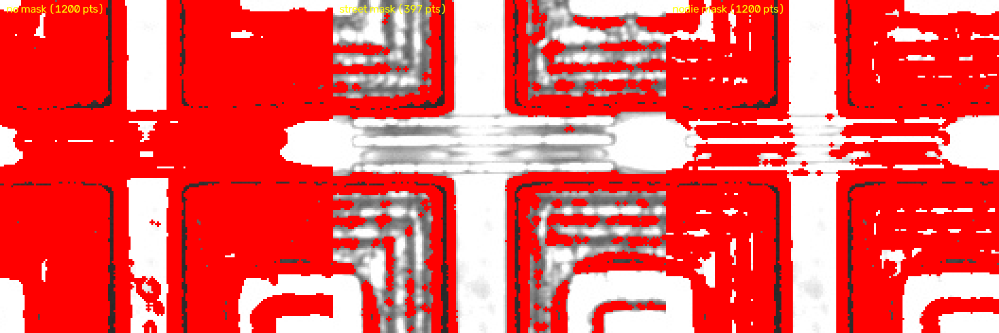

# GeoGUIDemo 使用说明（图文操作手册）

> 本文档面向第一次接触 GeoGUIDemo 的用户，按"界面长什么样 → 每一步点什么 → 结果怎么看"的顺序讲解。
> 建议配合程序实际操作一遍，10 分钟内即可上手。

> **只想先跑通一次？** 看 [三步测试 Demo](快速上手-三步测试Demo.md)（选目录 → 框模板 → 执行匹配），3 分钟即可。
> 本文档是完整手册，需要调参或排查时再看。

---

## 一、这是什么？

**GeoGUIDemo** 是一个基于 Dear ImGui 的**图形化模板匹配验证工具**。它的作用是：

1. 选一张**模板图**（你要找的目标的样子）；
2. 在模板图上**框选 ROI** 或**涂抹掩码**，决定哪些区域参与建模；
3. 创建**形状模型**；
4. 拿模型去**一张图或一整个目录**里做匹配，找到目标的位置/角度/尺度，并给出得分。

它对应命令行 `GeoMatchDemo.exe` 的图形版，适合**交互式调参**：拖一下滑块立刻看到分数变化。

---

## 二、如何启动

**方式 A：直接双击**
```
build_x64\GeoGUIDemo.exe
```
（或你常用的 `build\GeoGUIDemo.exe`，两个目录都有生成产物）

**方式 B：命令行带参数启动**（可指定初始目录）
```
build_x64\GeoGUIDemo.exe case1
```
`case1` 是默认目录，程序启动时会**自动**读取该目录下的 `temp.jpg` 建模板，并拿目录里第一张其它图跑一次匹配，方便你直接看到效果。

> 首次启动若提示找不到 `opencv_world455.dll`，把 `build_x64\opencv_world455.dll` 拷贝到 exe 同目录即可（见《常见问题》）。

---

## 三、界面总览

启动后窗口分**三栏**：

```
┌──────────────────────────────────────────────────────────────────────────────┐
│  GeoMatch 模板匹配验证工具                                                    │
├──────────┬───────────────────────────────────┬───────────────────────────────┤
│ 图片目录  │  图像视图                          │  参数面板                      │
│ (缩略图   │ ┌───────────────────────────────┐ │ ┌───────────────────────────┐ │
│  竖排)    │ │[匹配结果][目标图][模板源图][模板模型]│ │ │①匹配②模板参数③搜索参数④掩码   │ │
│          │ │                               │ │ │   /模型 ⑤界面/日志          │ │
│ ┌──────┐ │ │                               │ │ ├───────────────────────────┤ │
│ │缩略1 │ │ │        图像显示区              │ │ │ 0. 匹配方式（形状/NCC）      │ │
│ ├──────┤ │ │  （可框选 ROI / 涂抹掩码）      │ │ │ 1. 模板图像                 │ │
│ │缩略2 │ │ │                               │ │ │ 2. 匹配目标                 │ │
│ ├──────┤ │ │                               │ │ │ 3. 搜索参数                 │ │
│ │缩略3 │ │ └───────────────────────────────┘ │ │ 4. 执行匹配（+结果表格）     │ │
│ └──────┘ │                                   │ │ （滚轮上下滚，日志在最下方） │ │
│ 上一张    │                                   │ └───────────────────────────┘ │
│ 下一张    │                                   │                               │
└──────────┴───────────────────────────────────┴───────────────────────────────┘
```

> **「1~4」四块操作全在「① 匹配」页签里**（一站式；改完参数继续点执行即可）。
> 其它页签是同类参数的详细分组：② 模板参数 / ③ 搜索参数 / ④ 掩码·模型 / ⑤ 界面·日志。


**记住一句话**：**左看目录、中看图、右边点按钮。**

---
## 三之二、两种匹配方式（形状 / NCC）

参数面板「①匹配」页顶部有「0. 匹配方式」，两个单选：

| 方式 | 比什么 | 适合 | 不适合 |
|---|---|---|---|
| **形状匹配（梯度）** | 边缘的梯度方向 | 重复纹理里区分相似区域；需要尺度搜索 | 低对比度 / 模糊 / 纯纹理 |
| **NCC（灰度相关）** | 归一化灰度互相关 | 低对比度、模糊、纯纹理表面 | 重复纹理（处处相关都高）；**不搜尺度** |

切换时会**自动重建模型**并在日志里提示，因为两种模型格式不通用：
形状模型存 `.shm`，NCC 模型存 `.ncm`。

面板内容会随方式变化：

| 页签 | 形状匹配 | NCC |
|---|---|---|
| ②模板参数 | 起始角 / 角度范围 / 尺度范围 / 金字塔层数 / 对比度 / 最大点数 | 起始角 / 角度范围 / 角度步长 / 金字塔层数 / 极性 |
| ③搜索参数 | 最大匹配数 / 最大重叠 / 最小覆盖率 / 评分方式 / 亚像素 | 最大匹配数 / 最大重叠 / 亚像素 |
| ①匹配的判定 | 最小分数 + 覆盖率 + 评分方式 | 只有「NCC 判据（分数）」 |

NCC 模式下结果表的「覆盖」列显示 `-`、缩放恒为 `1.00`（NCC 没有尺度维度）。

启动参数：`GeoGUIDemo.exe --ncc case1` 直接以 NCC 方式启动；不加 `--ncc` 是形状匹配。

> 提示：NCC 一次搜索约 20 ms（1280×1024 图、154×148 模板、360°、20 核），
> 拖动参数滑块会实时重跑，所以调参时卡顿是正常的。

---


## 四、快速上手：三步完成一次匹配

### 第 1 步：选模板图

在参数面板「**1. 模板图像**」区块（①匹配页），点 **`选择模板图片...`**，在弹出的文件对话框里选一张图（例如 `case1/temp.jpg`）。

选完后：
- 图像视图的「**模板源图**」标签页会显示这张图；
- 程序若勾选了「自动运行」，会**立即**创建模板并匹配一次。

### 第 2 步：创建模板

确认参数没问题（首次保持默认即可），点 **`创建模板 / 应用参数`** 按钮。

创建成功后，图像视图的「**模板模型**」标签页会显示**模型轮廓 + 采样点**可视化图（绿线=模型轮廓，红点=实际参与评分的采样点，蓝点=中心），「⑤ 界面/日志」页签会打印 `模板已创建: ... 点数=... 层数=...`。

**创建模板后，切到「模板模型」标签页看到的画面**：


> **这一步是关键检查点**：轮廓应该贴在你想要的目标边缘上。如果轮廓散落到无关背景或纹理上，说明需要框选 ROI（第六节）或用掩码排除（第七节）。
> 「模板模型」默认**不画梯度箭头**：边缘细化后轮廓只有 1 像素宽，满屏箭头会把它盖住。
> 采样点是 1 像素红点，在 2 倍模型图上只有 2 像素，密集处会被绿线盖住——想看清单个点，用 ⑤界面/日志 的「显示缩放」放大。

### 第 3 步：选择目标并执行匹配

在参数面板「**2. 匹配目标**」区块：
- **匹配单张**：点 `选择单张图片...`；
- **匹配整个目录**：点 `选择图片目录...`。

然后在「**4. 执行匹配**」区块点 **`执行匹配`**。

匹配完成后：
- 图像视图的「**匹配结果**」标签页会显示用方框标出目标的结果图；
- 参数面板出现**结果表格**（分数、位置、角度、尺度）；
- 「⑤ 界面/日志」页签打印每张图的耗时和命中情况。

**匹配完成后，「匹配结果」标签页看到的画面**（绿色方框=匹配到的目标，框内细绿线=模型轮廓，框下方标注=分数/覆盖率/角度/缩放）：


---

## 五、中间图像视图：4 个标签页详解

图像视图顶部有 4 个标签页，点击切换：

| 标签页 | 内容 | 能否交互 |
|--------|------|----------|
| **匹配结果** | 匹配结果图（方框标注 + 模板纹理叠加） | 仅查看（可缩放/平移） |
| **目标图** | 当前搜索目标原图 | 可框选 ROI |
| **模板源图** | 模板原图 | 可框选 ROI + **涂抹掩码** |
| **模板模型** | 模型轮廓 + 采样点可视化 | 仅查看 |

> 左键拖框的颜色是**青色**——青色专指"你框的模板区域"，绿色专指"匹配到的目标"，两者不混用。

**显示缩放**：参数面板「⑤ 界面/日志」页签里有 `显示缩放` 滑块（0.1~8.0 倍），
用于放大/缩小图像显示，**不影响**匹配算法，只是看得更清楚。
每个标签页各记一套缩放/平移状态；滚轮缩放（以鼠标为锚点）、中键拖动平移、双击复位。

**图片列表**：最左「图片目录」栏是一列**竖排缩略图**（可滚动），列出目标目录里所有图片，
点击某个缩略图即可切换当前匹配目标；顶部还有 `上一张 / 下一张` 两个按钮。

### 可视化效果示例（真实程序输出）

「模板模型」标签页展示的模型轮廓/采样点可视化效果（绿线=模型轮廓、红点=参与评分的采样点、蓝点=中心）：


「匹配结果」标签页在搜索图上用方框标出目标的效果：


> 以上都是当前版本 GUI 的**实际截图**（`case1` 目录：模板 `case1/temp.jpg`、目标图 `tmp_grab_1762994178.jpg`，
> 结果 `s=0.998 c=1.00 a=-0.0deg k=1.000`）。
---

## 六、核心操作：框选 ROI 创建模板

框选 ROI 的作用是：**只把图上某一块矩形区域当作模板**，而不是整张图。

**操作步骤：**

1. 在「**目标图**」或「**模板源图**」标签页上，**按住鼠标左键拖动**，拉出一个矩形框；
2. 松开左键，程序会：
   - 把框内区域截取为新模板；
   - 立即（若开了自动运行）重建模型并匹配一次。

```
        ┌─────────────────┐
        │                 │
        │   ┌──────────┐  │
        │   │ 框选区域  │  │ ← 按住左键拖出的 ROI
        │   │ (将成为  │  │
        │   │  新模板) │  │
        │   └──────────┘  │
        │                 │
        └─────────────────┘
```

**适用场景**：目标只占大图的一小部分时，先框选出来，避免把无关背景也建进模型。

**完成后看哪**：图像视图切到「**模板模型**」标签页，轮廓会集中在你框选的区域内，说明模型点正确落在目标上。下图是"整幅模板建模"的模型轮廓分布：


---

## 七、核心操作：涂抹 / 加载掩码（mask）

掩码（mask）用于**精确控制模板里哪些像素参与建模**：
- **非零（白色）区域** → 参与建模；
- **零（黑色）区域** → 被排除，不参与建模。

这是提升识别稳定性的关键手段——例如晶圆十字标定场景，只保留"十字街道线条"、排除"die 晶粒表面"，分数稳定性会大幅提升（实测 ≥0.70 高分占比从 36% 提到 100%）。

### 方式 A：加载现成的掩码图

1. 参数面板「④ 掩码/模型」页签的「模板掩码」区块，点 **`加载掩码...`**；
2. 选择一张**与模板源图同尺寸**的黑白图（白色=参与，黑色=排除）；
3. 加载后「模板源图」标签页上被排除的区域会显示为**暗紫红色**；
4. 点 `创建模板` 生效。

> 现成掩码示例：`build_x64/tools/mask_street.png`（只保留街道线条）、`mask_nodie.png`（排除 die 内部）。

**加载"只保留街道"掩码后的效果**（暗紫红=被排除、不参与建模的区域）：


**加载"排除 die 内部"掩码后的效果**：


### 方式 B：直接在图上涂抹（交互式绘制）

1. 参数面板「④ 掩码/模型」页签，勾选 **`涂抹掩码模式`**；
2. 出现「画笔半径(px)」滑块，调到合适大小（如 10~15）；
3. 切到图像视图「**模板源图**」标签页；
4. 用鼠标涂抹：
   - **左键按住拖动** → 涂掉的区域置黑（**排除**），画面立即变**暗紫红**；
   - **右键按住拖动** → 恢复为白（**参与**），暗紫红消失；
5. 松手后程序**自动重建模板**，日志和「模板模型」点数会实时变化。

```
  模板源图                          说明
 ┌──────────────┐
 │  ░░░░░░░░░░  │  ░ = 暗紫红区域（被排除，不参与建模）
 │  ░░ ┌──┐ ░░  │  ┌──┐ = 保留的白色区域（参与建模）
 │  ░░ │  │ ░░  │
 │  ░░ └──┘ ░░  │
 │  ░░░░░░░░░░  │
 └──────────────┘
```

**清除掩码**：点 `清除掩码` 按钮，恢复为整幅模板参与建模。

### 掩码对模型点的影响（关键对比）

下图对比了三种建模方式下模型特征点的分布：



| 掩码方式 | 模型点数 | 说明 |
|----------|----------|------|
| 无掩码 | 1200 | 特征点散落在街道 + die 内部（die 表面纹理会拉低分数） |
| 只保留街道（street mask） | 397 | 特征点集中在十字街道线条上，分数最稳定 |
| 排除 die 内部（nodie mask） | 1200 | 介于两者之间 |

> 可以看到：**只保留街道**后，特征点全部落在稳定的街道几何边缘上，die 晶粒表面的颗粒/反光不再参与评分，这就是分数稳定性大幅提升的根本原因。

---

## 八、匹配结果怎么看

执行匹配后，参数面板「4. 执行匹配」区块会出现**结果表格**，关键列：

| 列 | 含义 |
|----|------|
| **分数** | 匹配置信度 0~1，越高越可靠（默认 ≥ 最小分数 才算命中） |
| **覆盖** | 模型点里"梯度方向一致"的占比（`-` = 未计算）。用来区分"真的目标"和"长得像的地方"，见第十节 Q6 |
| **位置 (x,y)** | 目标中心在搜索图中的坐标（像素） |
| **角度** | 检测到的旋转角（度） |
| **尺度** | 检测到的缩放倍率（1.0 = 无缩放） |

图像视图「**匹配结果**」标签页会用**绿色方框 + 模型轮廓折线**标出匹配到的目标（`#0` 绿框，其余实例橙框）。
轮廓是沿着模型边缘走的细线（1 像素，缩放 ≥2 倍时 2 像素），观感和 Halcon 的
`dev_display_shape_matching_results` 一致——**默认不画梯度箭头，也不画采样散点**。

「界面选项」里有三个显示开关（只影响画面，不影响匹配）：

| 开关 | 默认 | 说明 |
|---|---|---|
| 显示模型轮廓(折线) | 开 | 细绿线勾勒模型边缘 |
| 显示采样点 | 关 | 参与评分的红点，做诊断时开 |
| 显示梯度箭头 | 关 | 黄色箭头，会盖住细轮廓 |

**结果框的尺寸是固定的**：宽度/高度 = 模板尺寸 × 检测到的缩放倍率，且始终保持水平，不随检测到的角度倾斜。
这样同一工位连续多帧之间框的大小和朝向都一样，便于肉眼对比位置漂移；角度信息仍然写在框下方的标注里（`a=...`）。

需要看真实位姿时，可在「结果筛选」里把**结果框样式**改成 `旋转框`（跟着角度倾斜）或 `模型凸包`（旧版不规则多边形）。

**保存结果图**：点 `保存结果图`，把带标注的结果图导出为图片文件。

---

## 九、每个参数干什么（按界面分组）

> 这一节讲**界面上的每个控件**：默认值、它影响什么、什么时候该动它。
> 数值语义（取值范围的来由、实测对比）见 [参数手册.md](参数手册.md)，
> 两处不重复：这里只讲"你拖它会发生什么"。
>
> **最重要的分组原则**：右栏 ② 是**建模参数**（改了会**重建模板**），
> ① 里的"匹配判据"和 ③ 全是**搜索参数**（改了只**重跑匹配**，不重建）。

### 9.1 ② 模板参数 · 旋转与缩放

| 控件 | 默认 | 影响 | 场景 |
|---|---|---|---|
| 起始角(度) | **-180** | 允许的旋转范围起点 | 工件朝向固定时收窄 |
| 角度范围(度) | **360** | 旋转范围宽度 | **能收窄就收窄**：角度数是线性成本。实测 data1 全在 ±1.1°，设 20° 即可 |
| 角度步长(度, 0=自动) | **0（自动）** | 角度网格密度 | 一般不动；要复刻别人的网格才填 |
| 最小缩放 / 最大缩放 | **1.0 / 1.0** | 尺度范围（滑块 0.2~4.0） | 无缩放需求就都留 1.0（最快）。范围越宽越慢：140px 模板/1280×1024 单尺度 5 ms、0.2~2 → 31 ms、0.2~4 → 48 ms |

### 9.2 ② 模板参数 · 特征提取（决定"哪些点进模型"）

| 控件 | 默认 | 影响 | 场景 |
|---|---|---|---|
| 最小对比度(灰度差) | **3**（= 库里 12） | **滞后低阈值**：种子边周围比它强的边会被长回来 | **最先调这个。** 目标边缘模糊/低对比→调小；背景噪点多→调大。拉到 255 特征全消失 |
| 高阈值(灰度差) | **5.5**（自动跟随） | **滞后高阈值**：必须达到它才成为种子 | 建议保持「自动跟随」；手动填时锐边目标要调大（焊盘 30/40 灰度差时分数 0.679 → 0.961） |
| 高阈值自动跟随(推荐) | **开** | 让高阈值 = `lo×1.15+2`，保证低阈值拖动时是连续变化而非忽有忽无 | 一直开 |
| 最大点数(0=不限) | **1200** | 最细层保留多少模型点 | 大模板/密集纹理不够就加大；**0 只适合离线建模**（粗层点数暴涨，明显变慢） |

> **为什么会"全灭"**：高阈值一旦超过模板里最强的边，种子数=0 → 模型点瞬间为 0。
> 本机 `case1/temp.jpg` 的 Sobel 峰值只有 152（≈灰度差 38），灰度差拉到 32 左右就没点了 ——
> 这是模板本身的上限，不是 bug。

### 9.3 ② 模板参数 · 金字塔结构（建几层 / 多粗）

| 控件 | 默认 | 影响 | 场景 |
|---|---|---|---|
| 层数上限(0=自动) | **0** | 最多建几层 | **不要填 1**：1 层 = 全分辨率暴力搜索，比 3 层慢约 130 倍，结果完全一样 |
| 最粗层最短边(px) | **24** | 最粗一层的最短边下限，决定**模型能建多深** | **大图提速第一开关**。想多一层就要 `最短边 ≤ 模板短边 / 2^(N-1)`；实测 101px 模板 `12` 让 qfn1 从 48 → **8.3 ms**。代价是弱目标易被粗层糊掉，改小要验召回 |

> 界面提示已经写明：改这两个**会重建模型**。搜索用几层在 ③ 里，不用重建。

### 9.4 ① 匹配 · 匹配判据（最常调）

| 控件 | 默认 | 影响 | 场景 |
|---|---|---|---|
| 最小分数 | **0.70** | 低于此分不算命中（默认口径 mean，与 Halcon 一致） | 提高减误检；调低追召回时**必须**配合最小覆盖率 |
| 评分方式 | **mean(与 Halcon 一致)** | 最终分数的聚合方式 | **不要选 positive-mean**：错位置的假位姿能到 0.946（Halcon 同位置 0.556） |
| 最小覆盖率 | **0（关）** | 模型点里"方向一致"的占比下限；分母永远是全部模型点 | **假目标多就先开这个（0.75~0.90）**，比调 NMS 有效。实测真值 0.99 / 误检 0.62 |
| 弱梯度跳过 | **0（关）** | >0 时把"图像梯度弱"的模型点从分子分母一起去掉 | 模糊/弱对比帧分数 +0.1~0.3，但"只对上模板一部分"的位姿会被抬到 0.82+，**只在追召回时用** |
| 模板缺失上限 | **0.35** | 模板 4×4 格中"图像上没梯度"的格占比上限，超过即拒 | 拒掉"只对上模板一部分"的错位实例。0.30 太紧（真目标实测到 0.25） |
| 极性 | **要求极性一致** | `要求一致` / `忽略整体反转`（约慢 2×）/ `忽略逐点极性`（慢数倍） | 目标明暗反转、局部反光时用 |
| （NCC 模式）最小分数 | **0.70** | NCC 分数 [-1,1] | **NCC 负样本 top-1 就在 0.65~0.72**，真阳性 ≥0.98 ⇒ 建议 0.85~0.90，不能沿用 0.7 |

### 9.5 ③ 搜索参数 · 结果筛选（只影响"报几个 / 怎么画"）

| 控件 | 默认 | 影响 | 场景 |
|---|---|---|---|
| 最大匹配数 | **12** | 单图最多返回几个实例 | 多实例场景调大 |
| 最大重叠(1=关闭) | **1.0（关）** | 两个实例的模型框重叠超过该比例只留高分那个（按交集/较小框面积，与模板尺寸无关） | **推荐用它做去重**（Halcon 默认 0.5） |
| 最小间距(px) | **30** | 两实例中心的最小像素距离（旧口径，与模板尺寸挂钩） | 只在要用旧阈值时；两项同时生效，取更严的 |
| 结果框样式 | **固定方框** | `固定方框`（尺寸=模板×缩放，不随角度摇摆）/ `旋转框` / `模型凸包` | 多帧对比位置用固定方框；看姿态用旋转框。**只影响 Shape 绘制，NCC 不吃这个参数** |

### 9.6 ③ 搜索参数 · 速度与精度（**都不重建模型**）

| 控件 | 默认 | 影响 | 场景 |
|---|---|---|---|
| 搜索层数(0=全部) | **0** | 本次从模型的第几层开始粗扫（从最细层数起） | 目标清晰→用更粗层（快）；弱目标→调小到更细层（稳）。实测 4 层模型 `2/3/4` = 450 / 44.9 / **8.3 ms** |
| 搜索角度起点 / 搜索角度范围 | **0 / 0（=全部）** | **搜索期**角度子范围，可与建模范畴不同 | 已知工件最大偏转就设：实测 9.80 → ±10° **5.00 ms**，**不用重建模型**。范围内的真值分数/位置完全不变 |
| 超时(ms, 0=不限) | **0** | 超时后**返回已找到的结果**（不报错），日志标注 `[TIMEOUT: partial result]` | 产线要保证节拍时必设。粒度 ≈ 一个粗扫位姿（几 ms） |
| 贪婪度 | **0.90** | 越大越快、越可能漏 | 0.9~0.95。**不要为速度先动它，先动层数** |
| 亚像素 | **插值(抛物线)** | `关闭` / `插值` / `最小二乘(更准，稍慢)` | 高精度测量、软边用最小二乘 |
| OpenCL | **开** | 只用 GPU 做预处理（Sobel） | 很多机器只有集显、收益为负；测过再关 |

#### NCC 模式的 ③ 面板

| 控件 | 默认 | 说明 |
|---|---|---|
| 最大匹配数 | **1** | 多实例调大 |
| 最大重叠 | **0.5** | 与 Halcon NCC 默认一致 |
| 搜索层数(0=全部) | **0** | 从哪层开始粗扫，不必重建 |
| 搜索角度起点 / 范围 | **0 / 0（=全部）** | 实测 case1 14.39 → ±10° **10.18 ms** |
| 亚像素 | **插值** | NCC 只有 0/1 两档（Halcon NCC 同样只接受 true/false） |

### 9.7 ④ 掩码 / 模型文件

| 控件 | 说明 |
|---|---|
| 模板掩码 | 只有掩码内（非零）区域能产生模型点。模板里有会动的结构（丝印、反光、料号）时必用。可加载现成 png 或直接在「模板源图」上涂抹（左键=排除，右键=恢复） |
| 模型文件 | 保存为 `.shm` / 加载。**加载远快于重新建模**，产线只需建一次 |

### 9.8 ⑤ 界面 / 日志

| 开关 | 默认 | 作用 |
|---|---|---|
| 显示模型轮廓(折线) | **开** | 结果图上画模型轮廓（Halcon 风格） |
| 显示采样点 | **关** | 画参与评分的红点 |
| 显示梯度箭头 | **关** | 画黄色梯度箭头（会盖住细轮廓） |
| 参数改动后自动刷新 | **开** | 参数改完自动重建模板 + 重匹配 |
| 拖动时实时刷新 | **关** | 拖动滑块过程中实时刷新（可能卡顿；上一轮超过 150 ms 会自动等松手再算） |

### 9.9 一句话调参顺序

1. 建不出模型 → 降「最小对比度」或提高「最大点数」
2. 分数 0.5~0.7 上不去 → 先查对比度档位，再查散斑抢预算（CLI `-chain`）
3. 太慢 → 「最粗层最短边」→ 收窄角度/尺度范围 → 「搜索层数 / 搜索角度范围」
4. 有假目标 → 「最小覆盖率」→「模板缺失上限」→ 最后才动「最大重叠」


---

## 十、常见问题（FAQ）

**Q1：双击 exe 没反应 / 提示缺 DLL？**
A：把 `build_x64\opencv_world455.dll` 拷贝到 exe 同目录（或把 exe 所在目录加入 PATH）。

**Q2：点了"涂抹掩码模式"后，左键涂抹画面没变化？**
A：确认①勾选了「涂抹掩码模式」；②在图像视图「**模板源图**」标签页（不是"目标图"）上涂抹；③左键=排除（变暗紫红），右键=恢复。

**Q3：模板模型标签页里的绿线、红点、蓝点是什么？**
A：绿线=模型轮廓（按边缘链顺序连线，等价于 Halcon 的 `get_shape_model_contours`），红点=实际参与评分的采样点（轮廓上等弧长抽出来的子集），蓝点=模板中心。为避免 1 像素宽的轮廓被箭头盖住，梯度箭头默认关闭。

**Q4：图片列表在哪？怎么切换图片？**
A：最左「图片目录」栏是一列竖排缩略图（可滚动），点缩略图即可切换当前目标图；也可以用 `上一张 / 下一张` 按钮。

**Q5：如何只匹配目录里的部分图片？**
A：先「选择图片目录」，然后在最左「图片目录」栏的缩略图列表里点选要匹配的图，再点「执行匹配」。

**Q6：把「最小分数」调低后，错误位置很多、而且分数还挺高，怎么办？**

A：这是**模板判别力不足 + 图形重复**造成的，不是搜错了。两个典型数据集都验证了这一点：

- `case1`（内圆角 + 十字街道）：图上每个 cell 都有同样的圆角，低阈值下必然多处出峰。
- `case3`（载物台移动的十字路口，180 帧）：默认参数 `minScore=0.55` 就已经 **50 个真 + 49 个假**。

按下面顺序处理：

1. **先开「最小覆盖率」**（一个参数就能解决大部分情况）。它 = 模型点里梯度方向一致的占比，"只对上一半"的位置会明显偏低。
   - case1：真实位置 0.99、相似位置 0.62 → 取 0.80；
   - case3：真实 0.81、误检 0.75 → 只能取 0.78（窗口很窄）。
   - **实战效果**：case3 默认参数下只加 `-min-cover 0.78`，误检从 49 降到 1（F1 0.671 → 0.980）。
2. **换「评分方式」为 `clipped-mean`**。它不会自己减少误检数量（位置集合不变），但会把误检的分数显著压低
   （case3：误检 0.92 → 0.67，真值 0.94 → 0.77），于是你就可以用一个分数阈值把它们筛掉。
   ⚠️ 注意不要把「最小分数」抬太高来筛选：它同时参与搜索剪枝，case3 里 `minScore=0.85` 会让召回直接掉到 2%。
   **要"搜索阈值保持低 + 靠分数/覆盖率筛"**。
3. **还不行就改模板**：用「涂抹掩码模式」把全图重复的圆角/直线/器件阵列涂掉，只留下唯一结构。
   case3 实测：只保留十字带，误检从 49 降到 9；再叠 `cov>=.80` 得到 4 个误检、F1 0.962 且召回满。
   （掩码会让分数整体下移，`minScore` 要相应放低。）
4. **固定工位就加位置先验**：把搜索图裁到目标一定出现的区域，比任何调参都可靠。

> 判断依据：真值和误检的**覆盖率差得明显**（如 case1 的 0.99 vs 0.62）→ 调阈值即可；
> **差得勉强**（如 case3 的 0.81 vs 0.75）→ 阈值只能救急，必须回到第 3 步改模板/掩码。
>
> 另外两个常见误区：`minContrast` 调高不一定更好（case3 提到 30/50 反而误检从 49 涨到 75/102，
> 因为点集中到了同样重复的强边缘上）；`maxPoints` 的效果**非单调**（case3 上 250 点 F1=1.00，
> 300 点掉到 0.44，800 点又回到 1.00），不能当通用手段用。

**Q7：拖动「最小对比度」，点数一开始不动、后来突然全变成 0，是不是有 bug？**

A：两种都是正常现象，各有原因：

1. **点数不动**——`maxPoints` 在截断。候选像素（过阈值的像素）远多于最大点数时，调阈值只是换"取哪 1200 个点"，
   点数仍然被钉在 1200。建模板后日志会直接告诉你：`提示: 过阈值像素 N 个 > 点数 1200 的两倍，当前是「最大点数」在截断`。
   想看阈值效果，把「最大点数」调大（如 4000）或看日志里的候选像素数。
2. **突然全变成 0**——高阈值超过了模板里最强的边。滞后阈值要求先有种子（`|g| >= 高阈值`），
   种子数为 0 就没有任何点。本机 `case1/temp.jpg` 的 Sobel 峰值是 152（≈灰度差 38），
   所以灰度差到 32 左右就归零。勾上「高阈值自动跟随」能把这段区间拉平：
   灰度差 3→32 是 3232→2404→1462→1159→730→184→24→0 的连续曲线，不会出现中间某个值突然归零。

