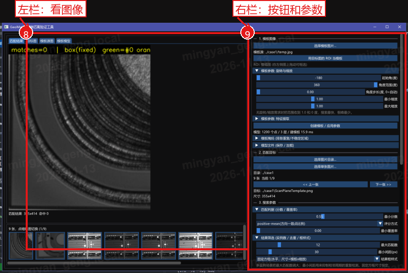
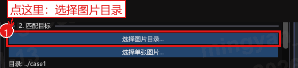
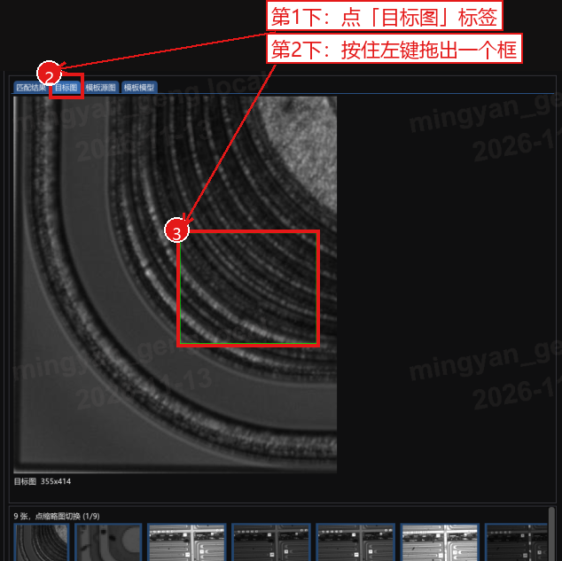
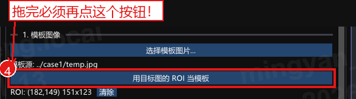
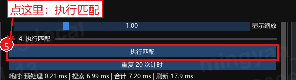
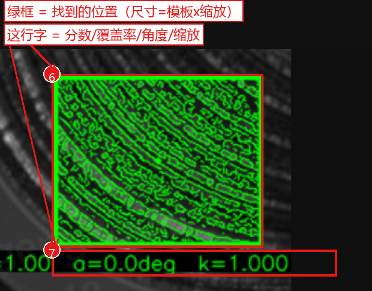

# 三步测试 Demo（第一次使用看这里）

> 目标：不看其它文档，3 分钟跑通一次"选目录 → 框模板 → 执行匹配"。
> 对应版本：GeoGUIDemo 1.0.3

---

## 准备

双击 `GeoGUIDemo.exe` 运行。程序会自动做两件事（日志区能看到）：

```
环境: OpenCV 4.5.5 ... 4096 MB ...
模板源图: case1/temp.jpg (154x148)
模板已创建: 154x148  点数=1200  层数=3  用时 15.6 ms
目录: case1  9 张图片 (缩略图 42 ms)
匹配: 1 个结果  ...
```

说明内置示例已经跑通了一次。**如果日志里报"没有默认模板 case1/temp.jpg"，请点「1. 模板图像 → 选择模板图片...」随便选一张图。**

界面分左右两栏：**左边"看"**（图像），**右边"操作"**（参数和按钮）。



---

## 第 1 步：选择图片目录

在**右栏**找到「**2. 匹配目标**」，点 **`选择图片目录...`**，选一个装有待检图片的文件夹。



图上红框标出的就是那个按钮（在右栏中部「2. 匹配目标」下面）。

点完会看到：

- 下方出现 `目录: D:\xxx  N 张`、`N 张  当前 1/N`
- **左栏底部**出现一排缩略图，第 1 张已被选中
- 左栏「**目标图**」标签页显示这张图

> 只有一张图也行，用 `选择单张图片...` 更直接。

---

## 第 2 步：框选模板

1. 左栏顶部点 **`目标图`** 标签页，让当前显示的是**要匹配的那张图**；
2. 在图上**按住鼠标左键拖动**，拉出一个矩形，松开；
3. 框要**至少 8×8 像素**，太小会被忽略（日志会提示"框选 ROI"或直接没反应）。



松开后，图上会留下一个**绿色方框**，右栏「1. 模板图像」下方会显示
`ROI: (x,y) 宽x高`。

### ⚠️ 然后必须点一下这个按钮

点右栏「**1. 模板图像**」里的 **`用目标图的 ROI 当模板`**（见下图红框）。



**为什么必须点**：程序启动时已经把 `case1/temp.jpg` 当成了模板源。在这种"已有模板源"的情况下，
在「目标图」上拖框只是记下了 ROI，**不会**自动替换模板。点这个按钮才会把框里那块图截出来当新模板。

日志会打印：

```
已截取模板: (820,650) 180x160
模板已创建: 180x160  点数=1200  层数=3  用时 12.3 ms
```

> **另一种做法**（等价）：不点上面那个按钮，而是到左栏「**模板源图**」标签页上拖框。
> 在模板源图上拖框会**直接**改变建模区域，松开即自动重建模板。
> 两种方式选一种即可，别混淆 —— 记住：**目标图上的框 = 候选模板，要点按钮才生效；模板源图上的框 = 直接生效**。

---

## 第 3 步：执行匹配

右栏滚到底部「**4. 执行匹配**」，点 **`执行匹配`**。



> 如果右栏看不到这个按钮，把鼠标放在右栏上**向下滚一下滚轮**就有了
> （右栏「1~4」四块是全的，只是需要滚动）。

日志会打印这一帧的耗时和命中的分数：

```
匹配: 1 个结果  预处理 1.4 ms  搜索 45.6 ms  搜索总耗时 45.6 ms (1 次)  合计 47.0 ms
  #0  s=0.988  c=0.99  a=-0.1deg  k=1.000  pos=(841;674)
```

---

## 结果怎么看

左栏点 **`匹配结果`** 标签页，会看到：



| 画面元素 | 含义 |
|---|---|
| **绿色矩形框** | 匹配到的目标位置，尺寸 = 模板尺寸 × 缩放倍率，**始终水平** |
| **框内细绿线** | 模型轮廓（Halcon 风格），贴住目标边缘说明匹配正确 |
| **框下方一行字** | `#0 s=0.988 c=0.99 a=-0.1deg k=1.000` |

那行字的含义：

| 字段 | 含义 | 好坏的判断 |
|---|---|---|
| `#0` | 第几个结果，`#0` 是最优 | — |
| `s=` | 分数 0~1 | ≥0.8 基本可信，≥0.9 很稳 |
| `c=` | 覆盖率（方向一致的点占比） | 真值通常 ≥0.85，误检常 <0.7 |
| `a=` | 旋转角（度） | 框是水平的，角度只看这个数 |
| `k=` | 缩放倍率 | 1.000 = 没有缩放 |

**多张图连续看**：左栏底部点缩略图切下一张，切图会自动重匹配一次。

---

## 常见问题

**Q：拖框没反应？**
确认点在「**目标图**」或「**模板源图**」标签页上（「匹配结果」「模板模型」页不能框选）。
另外框要 ≥8×8 像素。

**Q：点了「用目标图的 ROI 当模板」提示"ROI 太小"？**
框太小或没框。重新拖一个大一点的框。

**Q：执行匹配后 `matches = 0`（没命中）？**
先看日志里的分数。如果分数在 0.4~0.5 上下，说明"看到了但不够像"，把右栏
「3. 搜索参数 → 匹配判据」里的 **`最小分数`** 调低到 0.4 再试。
如果分数很低（<0.3），多半是框选的区域里没有可区分特征，换一块区域。

**Q：想清掉框？**
右栏「1. 模板图像」下方 ROI 那行末尾有个 **`清除`** 按钮。

**Q：想看更快/更准的效果？**
- 「3. 搜索参数 → 匹配判据」把 **`最小分数`** 调到 0.7 以上，误检更少；
- 不需要旋转就在「模板参数: 旋转与缩放」把**角度范围**收到 `0`，会快很多；
- **不要**把「模板参数: 特征提取 → 金字塔层数」设成 `1`（会慢上百倍，且结果一样）。

---

## 极简路径（连框选都跳过）

只想确认程序能跑：

1. 双击 `GeoGUIDemo.exe`（自动加载 `case1`）；
2. 左栏切到「**匹配结果**」；
3. 就完了 —— 启动时已经自动建模板并匹配过第一张。

---

## 名词对照（右侧面板）

| 区块 | 作用 |
|---|---|
| **1. 模板图像** | 选模板图 / 用目标图 ROI 当模板 / 建模参数 / 掩码 / 保存加载模型 |
| **2. 匹配目标** | 选目录或单张图，切上一张/下一张 |
| **3. 搜索参数** | 最小分数、评分方式、覆盖率、框样式、加速选项、显示开关 |
| **4. 执行匹配** | 执行匹配 / 重复 20 次计时 / 结果表格 / 保存结果图 |
| **日志** | 所有动作的耗时与提示，出问题先看这里 |
